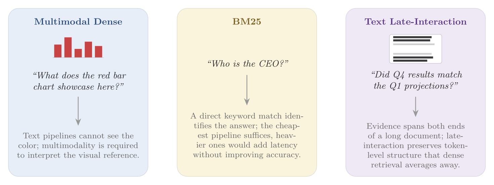
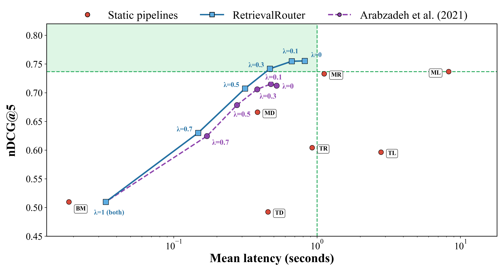

# RetrievalRouter: Joint Modality and Architecture Selection for Document Retrieval

<p align="center">
  <a href="https://2026.emnlp.org"></a>
  <a href="https://arxiv.org/pdf/2608.25625"></a>
  <a href="https://huggingface.co/collections/emrekuruu/retrieval-router"></a>
  <a href="LICENSE"></a>
</p>

<p align="center">
  <strong>Emre Kuru · Mehmet Onur Keskin · Reza Farahbakhsh · Noel Crespi</strong>
</p>

This repository is the official implementation of [**RetrievalRouter: Joint Modality and Architecture Selection for Document Retrieval**](https://arxiv.org/pdf/2608.25625).

<p align="center">
  <a href="#motivation">Motivation</a> ·
  <a href="#results">Results</a> ·
  <a href="#models-data-and-predictions">Models & Data</a> ·
  <a href="#quick-start">Quick Start</a> ·
  <a href="#repository-structure">Repository</a> ·
  <a href="#citation">Citation</a>
</p>

## Motivation

Document retrieval pipelines make different trade-offs across modality, architecture, effectiveness, and cost. Figure 1 shows why a fixed pipeline is inadequate: visual references require multimodal retrieval, direct factoids may need only BM25, and long-context comparisons benefit from fine-grained interaction.

<p align="center">
  
</p>

<p align="center"><em>Different queries require different retrieval capabilities.</em></p>

## Results

Across benchmarks spanning financial and scientific corpora, **no static pipeline dominates**. RetrievalRouter learns, from the query text alone, which retrieval pipeline best fits each query. **For every static baseline, RetrievalRouter offers an operating point that is simultaneously more accurate and faster.**

<p align="center">
  
</p>

<p align="center"><em>Static pipelines, RetrievalRouter operating points, and the adapted Arabzadeh et al. (2021) baseline. Adaptive latency includes 15 ms of policy inference once per query.</em></p>

## Models, Data, and Predictions

The [Hugging Face collection](https://huggingface.co/collections/emrekuruu/retrieval-router) provides every released dataset and all trained RetrievalRouter and baseline checkpoints.

| Benchmark | Dataset | Queries | Documents | Avg. tokens |
|---|---|---:|---:|---:|
| REAL-MM-RAG | FinReport | 853 | 2,687 | 1,053 |
| REAL-MM-RAG | FinSlides | 1,048 | 2,280 | 275 |
| T2-RAGBench | FinQA | 6,232 | 2,789 | 965 |
| T2-RAGBench | ConvFinQA | 3,431 | 1,806 | 966 |
| T2-RAGBench | VQAonBD | 9,772 | 1,787 | 780 |
| T2-RAGBench | TAT-DQA | 27,127 | 2,758 | 852 |
| MMDocRAG | ArxivQA | 9,034 | 4,749 | 1,110 |
| MMDocRAG | Wiki-SS | 14,968 | 12,752 | 777 |
| MMDocRAG | MP-DocVQA | 5,581 | 2,350 | 388 |
| MMDocRAG | SciQAG | 4,496 | 2,595 | 1,196 |
| MMDocRAG | DUDE | 2,561 | 2,073 | 516 |

**Total: 85,103 queries across 11 datasets.**

This repository also includes the final five-arm training data and all test prediction files used in the paper:

```text
train/data/updated_dataset.xlsx
evaluation/predictions/
├── retrievalrouter_l00.xlsx
├── retrievalrouter_l10.xlsx
├── retrievalrouter_l30.xlsx
├── retrievalrouter_l50.xlsx
├── retrievalrouter_l70.xlsx
├── retrievalrouter_l100.xlsx
└── baseline.xlsx
```

Each prediction file contains the same 8,506 unique test queries and the raw pipeline metrics required to reproduce aggregate results and paired significance tests.

## Quick Start

```bash
git clone https://github.com/emrekuruu/retrieval-router.git
cd retrieval-router
```

### Retrieval

Run BM25 on a configured dataset:

```bash
python -m venv .venv-retrieval
source .venv-retrieval/bin/activate
pip install -r requirements/base_pipelines_requirements.txt

TASK=finqa DATASET=<hugging-face-dataset-id> ./scripts/retrieval/bm25.sh
```

Text and multimodal indexing/retrieval launchers are available under `scripts/`.

### Training

Train RetrievalRouter at $\lambda=0.1$:

```bash
python -m venv .venv-training
source .venv-training/bin/activate
pip install -r requirements/training_requirements.txt

OBJECTIVE=retrievalrouter LAMBDA=0.1 python -m train.prepare_data
OBJECTIVE=retrievalrouter LAMBDA=0.1 python -m train.train
```

Use another `LAMBDA` value for a different frontier point, or set `OBJECTIVE=baseline` to train the adapted baseline.

### Evaluation

Reproduce the headline result from the included predictions:

```bash
python -m venv .venv-eval
source .venv-eval/bin/activate
pip install -r requirements/evaluation_requirements.txt

python -m evaluation.overall_metrics \
  --predictions evaluation/predictions/retrievalrouter_l10.xlsx \
  --output evaluation/metrics_summary.xlsx
```

Expected result:

```text
nDCG@5:       0.754739
Mean latency: 0.665978 s
```

Paired significance scripts are provided for static pipelines and the adaptive baseline.

## Repository Structure

```text
retrieval-router/
├── arms.py                         # Pipelines, router arms, names, colors, overhead
├── assets/                         # Paper figures used in this README
├── data_collection/
│   ├── dataset_loader.py
│   ├── embedders/                  # Text and multimodal embedders
│   ├── pipelines/                  # BM25, indexing, retrieval, and reranking
│   └── vector_databases/           # Qdrant abstraction and implementation
├── train/
│   ├── data/updated_dataset.xlsx   # Final five-arm training data
│   ├── objectives/
│   │   ├── retrievalrouter.py
│   │   └── baseline.py
│   ├── hf_model/                   # Hugging Face RetrievalRouter implementation
│   ├── prepare_data.py
│   ├── train.py
│   └── inference.py
├── evaluation/
│   ├── predictions/                # RetrievalRouter and baseline predictions
│   ├── overall_metrics.py
│   ├── statistical_testing.py
│   ├── run_static_significance.py
│   └── run_adaptive_significance.py
├── scripts/                         # Indexing and retrieval launchers
└── requirements/                    # Retrieval, training, and evaluation environments
```

## Citation

```bibtex
@misc{kuru2026retrievalrouterjointmodalityarchitecture,
      title={RetrievalRouter: Joint Modality and Architecture Selection for Document Retrieval}, 
      author={Emre Kuru and Mehmet Onur Keskin and Reza Farahbakhsh and Noel Crespi},
      year={2026},
      eprint={2608.25625},
      archivePrefix={arXiv},
      primaryClass={cs.IR},
      url={https://arxiv.org/abs/2608.25625}, 
}
```

## License

This repository is released under the [MIT License](LICENSE).

## Acknowledgments

RetrievalRouter builds on open-source work from [Qdrant](https://github.com/qdrant/qdrant), [PyLate](https://github.com/lightonai/pylate), [ColPali](https://github.com/illuin-tech/colpali), Hugging Face, and the broader document-retrieval community.
# Large Files (HuggingFace)

All large files (model weights, datasets, embeddings, checkpoints) are stored on HuggingFace:
**https://huggingface.co/datasets/lumos2548/retrieval-router-assets**

Download each file to the corresponding local path. Example:
```bash
wget https://huggingface.co/datasets/lumos2548/retrieval-router-assets/resolve/main/retrieval-router/models/model_retrievalrouter_l10/checkpoint-4256/model.safetensors
```

---

## analysis/replay_data (102 files, 13.66GB)

| File | Size | Download |
|------|------|----------|
| `analysis/replay_data/corpus/arxivqa/pages.parquet` | 2.04G | [下载](https://huggingface.co/datasets/lumos2548/retrieval-router-assets/resolve/main/retrieval-router/analysis/replay_data/corpus/arxivqa/pages.parquet) |
| `analysis/replay_data/corpus/finqa/pages.parquet` | 1.14G | [下载](https://huggingface.co/datasets/lumos2548/retrieval-router-assets/resolve/main/retrieval-router/analysis/replay_data/corpus/finqa/pages.parquet) |
| `analysis/replay_data/corpus/finreport/pages.parquet` | 668.5M | [下载](https://huggingface.co/datasets/lumos2548/retrieval-router-assets/resolve/main/retrieval-router/analysis/replay_data/corpus/finreport/pages.parquet) |
| `analysis/replay_data/corpus/mp-docvqa/pages.parquet` | 1.03G | [下载](https://huggingface.co/datasets/lumos2548/retrieval-router-assets/resolve/main/retrieval-router/analysis/replay_data/corpus/mp-docvqa/pages.parquet) |
| `analysis/replay_data/corpus/sciqag/pages.parquet` | 1.26G | [下载](https://huggingface.co/datasets/lumos2548/retrieval-router-assets/resolve/main/retrieval-router/analysis/replay_data/corpus/sciqag/pages.parquet) |
| `analysis/replay_data/corpus/tatdqa/pages.parquet` | 892.9M | [下载](https://huggingface.co/datasets/lumos2548/retrieval-router-assets/resolve/main/retrieval-router/analysis/replay_data/corpus/tatdqa/pages.parquet) |
| `analysis/replay_data/corpus/vqaonbd/pages.parquet` | 591.7M | [下载](https://huggingface.co/datasets/lumos2548/retrieval-router-assets/resolve/main/retrieval-router/analysis/replay_data/corpus/vqaonbd/pages.parquet) |
| `analysis/replay_data/corpus/wiki-ss/pages.parquet` | 3.92G | [下载](https://huggingface.co/datasets/lumos2548/retrieval-router-assets/resolve/main/retrieval-router/analysis/replay_data/corpus/wiki-ss/pages.parquet) |
| `analysis/replay_data/emb/arxivqa/MD_dense.npz` | 65.3M | [下载](https://huggingface.co/datasets/lumos2548/retrieval-router-assets/resolve/main/retrieval-router/analysis/replay_data/emb/arxivqa/MD_dense.npz) |
| `analysis/replay_data/emb/arxivqa/MR_multi.npz` | 71.1M | [下载](https://huggingface.co/datasets/lumos2548/retrieval-router-assets/resolve/main/retrieval-router/analysis/replay_data/emb/arxivqa/MR_multi.npz) |
| `analysis/replay_data/emb/finqa/MD_dense.npz` | 38.4M | [下载](https://huggingface.co/datasets/lumos2548/retrieval-router-assets/resolve/main/retrieval-router/analysis/replay_data/emb/finqa/MD_dense.npz) |
| `analysis/replay_data/emb/finqa/MR_multi.npz` | 107.5M | [下载](https://huggingface.co/datasets/lumos2548/retrieval-router-assets/resolve/main/retrieval-router/analysis/replay_data/emb/finqa/MR_multi.npz) |
| `analysis/replay_data/emb/finqa/TD_dense.npz` | 43.8M | [下载](https://huggingface.co/datasets/lumos2548/retrieval-router-assets/resolve/main/retrieval-router/analysis/replay_data/emb/finqa/TD_dense.npz) |
| `analysis/replay_data/emb/finqa/TR_multi.npz` | 103.3M | [下载](https://huggingface.co/datasets/lumos2548/retrieval-router-assets/resolve/main/retrieval-router/analysis/replay_data/emb/finqa/TR_multi.npz) |
| `analysis/replay_data/emb/finreport/TD_dense.npz` | 42.3M | [下载](https://huggingface.co/datasets/lumos2548/retrieval-router-assets/resolve/main/retrieval-router/analysis/replay_data/emb/finreport/TD_dense.npz) |
| `analysis/replay_data/emb/finreport/TR_multi.npz` | 28.0M | [下载](https://huggingface.co/datasets/lumos2548/retrieval-router-assets/resolve/main/retrieval-router/analysis/replay_data/emb/finreport/TR_multi.npz) |
| `analysis/replay_data/emb/mp-docvqa/MD_dense.npz` | 32.2M | [下载](https://huggingface.co/datasets/lumos2548/retrieval-router-assets/resolve/main/retrieval-router/analysis/replay_data/emb/mp-docvqa/MD_dense.npz) |
| `analysis/replay_data/emb/mp-docvqa/MR_multi.npz` | 69.1M | [下载](https://huggingface.co/datasets/lumos2548/retrieval-router-assets/resolve/main/retrieval-router/analysis/replay_data/emb/mp-docvqa/MR_multi.npz) |
| `analysis/replay_data/emb/sciqag/TD_dense.npz` | 41.0M | [下载](https://huggingface.co/datasets/lumos2548/retrieval-router-assets/resolve/main/retrieval-router/analysis/replay_data/emb/sciqag/TD_dense.npz) |
| `analysis/replay_data/emb/sciqag/TR_multi.npz` | 97.9M | [下载](https://huggingface.co/datasets/lumos2548/retrieval-router-assets/resolve/main/retrieval-router/analysis/replay_data/emb/sciqag/TR_multi.npz) |
| `analysis/replay_data/emb/tatdqa/MD_dense.npz` | 38.1M | [下载](https://huggingface.co/datasets/lumos2548/retrieval-router-assets/resolve/main/retrieval-router/analysis/replay_data/emb/tatdqa/MD_dense.npz) |
| `analysis/replay_data/emb/tatdqa/MR_multi.npz` | 302.8M | [下载](https://huggingface.co/datasets/lumos2548/retrieval-router-assets/resolve/main/retrieval-router/analysis/replay_data/emb/tatdqa/MR_multi.npz) |
| `analysis/replay_data/emb/vqaonbd/MD_dense.npz` | 24.6M | [下载](https://huggingface.co/datasets/lumos2548/retrieval-router-assets/resolve/main/retrieval-router/analysis/replay_data/emb/vqaonbd/MD_dense.npz) |
| `analysis/replay_data/emb/vqaonbd/MR_multi.npz` | 72.6M | [下载](https://huggingface.co/datasets/lumos2548/retrieval-router-assets/resolve/main/retrieval-router/analysis/replay_data/emb/vqaonbd/MR_multi.npz) |
| `analysis/replay_data/emb/wiki-ss/MD_dense.npz` | 179.4M | [下载](https://huggingface.co/datasets/lumos2548/retrieval-router-assets/resolve/main/retrieval-router/analysis/replay_data/emb/wiki-ss/MD_dense.npz) |
| `analysis/replay_data/emb/wiki-ss/MR_multi.npz` | 466.2M | [下载](https://huggingface.co/datasets/lumos2548/retrieval-router-assets/resolve/main/retrieval-router/analysis/replay_data/emb/wiki-ss/MR_multi.npz) |
| `analysis/replay_data/emb/wiki-ss/TD_dense.npz` | 204.3M | [下载](https://huggingface.co/datasets/lumos2548/retrieval-router-assets/resolve/main/retrieval-router/analysis/replay_data/emb/wiki-ss/TD_dense.npz) |
| `analysis/replay_data/emb/wiki-ss/TR_multi.npz` | 195.4M | [下载](https://huggingface.co/datasets/lumos2548/retrieval-router-assets/resolve/main/retrieval-router/analysis/replay_data/emb/wiki-ss/TR_multi.npz) |
| `analysis/replay_data/runs/1962_MD.json` | 0.0M | [下载](https://huggingface.co/datasets/lumos2548/retrieval-router-assets/resolve/main/retrieval-router/analysis/replay_data/runs/1962_MD.json) |
| `analysis/replay_data/runs/1962_MR.json` | 0.0M | [下载](https://huggingface.co/datasets/lumos2548/retrieval-router-assets/resolve/main/retrieval-router/analysis/replay_data/runs/1962_MR.json) |
| `analysis/replay_data/runs/2013_MD.json` | 0.0M | [下载](https://huggingface.co/datasets/lumos2548/retrieval-router-assets/resolve/main/retrieval-router/analysis/replay_data/runs/2013_MD.json) |
| `analysis/replay_data/runs/2013_MR.json` | 0.0M | [下载](https://huggingface.co/datasets/lumos2548/retrieval-router-assets/resolve/main/retrieval-router/analysis/replay_data/runs/2013_MR.json) |
| `analysis/replay_data/runs/2330_MD.json` | 0.0M | [下载](https://huggingface.co/datasets/lumos2548/retrieval-router-assets/resolve/main/retrieval-router/analysis/replay_data/runs/2330_MD.json) |
| `analysis/replay_data/runs/2330_MR.json` | 0.0M | [下载](https://huggingface.co/datasets/lumos2548/retrieval-router-assets/resolve/main/retrieval-router/analysis/replay_data/runs/2330_MR.json) |
| `analysis/replay_data/runs/2481_MD.json` | 0.0M | [下载](https://huggingface.co/datasets/lumos2548/retrieval-router-assets/resolve/main/retrieval-router/analysis/replay_data/runs/2481_MD.json) |
| `analysis/replay_data/runs/2481_MR.json` | 0.0M | [下载](https://huggingface.co/datasets/lumos2548/retrieval-router-assets/resolve/main/retrieval-router/analysis/replay_data/runs/2481_MR.json) |
| `analysis/replay_data/runs/2544_MD.json` | 0.0M | [下载](https://huggingface.co/datasets/lumos2548/retrieval-router-assets/resolve/main/retrieval-router/analysis/replay_data/runs/2544_MD.json) |
| `analysis/replay_data/runs/2544_MR.json` | 0.0M | [下载](https://huggingface.co/datasets/lumos2548/retrieval-router-assets/resolve/main/retrieval-router/analysis/replay_data/runs/2544_MR.json) |
| `analysis/replay_data/runs/2899_MD.json` | 0.0M | [下载](https://huggingface.co/datasets/lumos2548/retrieval-router-assets/resolve/main/retrieval-router/analysis/replay_data/runs/2899_MD.json) |
| `analysis/replay_data/runs/2899_MR.json` | 0.0M | [下载](https://huggingface.co/datasets/lumos2548/retrieval-router-assets/resolve/main/retrieval-router/analysis/replay_data/runs/2899_MR.json) |
| `analysis/replay_data/runs/3180_MD.json` | 0.0M | [下载](https://huggingface.co/datasets/lumos2548/retrieval-router-assets/resolve/main/retrieval-router/analysis/replay_data/runs/3180_MD.json) |
| `analysis/replay_data/runs/3180_MR.json` | 0.0M | [下载](https://huggingface.co/datasets/lumos2548/retrieval-router-assets/resolve/main/retrieval-router/analysis/replay_data/runs/3180_MR.json) |
| `analysis/replay_data/runs/3341_MD.json` | 0.0M | [下载](https://huggingface.co/datasets/lumos2548/retrieval-router-assets/resolve/main/retrieval-router/analysis/replay_data/runs/3341_MD.json) |
| `analysis/replay_data/runs/3341_MR.json` | 0.0M | [下载](https://huggingface.co/datasets/lumos2548/retrieval-router-assets/resolve/main/retrieval-router/analysis/replay_data/runs/3341_MR.json) |
| `analysis/replay_data/runs/343_MD.json` | 0.0M | [下载](https://huggingface.co/datasets/lumos2548/retrieval-router-assets/resolve/main/retrieval-router/analysis/replay_data/runs/343_MD.json) |
| `analysis/replay_data/runs/343_MR.json` | 0.0M | [下载](https://huggingface.co/datasets/lumos2548/retrieval-router-assets/resolve/main/retrieval-router/analysis/replay_data/runs/343_MR.json) |
| `analysis/replay_data/runs/343_TD.json` | 0.0M | [下载](https://huggingface.co/datasets/lumos2548/retrieval-router-assets/resolve/main/retrieval-router/analysis/replay_data/runs/343_TD.json) |
| `analysis/replay_data/runs/343_TR.json` | 0.0M | [下载](https://huggingface.co/datasets/lumos2548/retrieval-router-assets/resolve/main/retrieval-router/analysis/replay_data/runs/343_TR.json) |
| `analysis/replay_data/runs/4094_MD.json` | 0.0M | [下载](https://huggingface.co/datasets/lumos2548/retrieval-router-assets/resolve/main/retrieval-router/analysis/replay_data/runs/4094_MD.json) |
| `analysis/replay_data/runs/4094_MR.json` | 0.0M | [下载](https://huggingface.co/datasets/lumos2548/retrieval-router-assets/resolve/main/retrieval-router/analysis/replay_data/runs/4094_MR.json) |
| `analysis/replay_data/runs/4188_MD.json` | 0.0M | [下载](https://huggingface.co/datasets/lumos2548/retrieval-router-assets/resolve/main/retrieval-router/analysis/replay_data/runs/4188_MD.json) |
| `analysis/replay_data/runs/4188_MR.json` | 0.0M | [下载](https://huggingface.co/datasets/lumos2548/retrieval-router-assets/resolve/main/retrieval-router/analysis/replay_data/runs/4188_MR.json) |
| `analysis/replay_data/runs/4217_MD.json` | 0.0M | [下载](https://huggingface.co/datasets/lumos2548/retrieval-router-assets/resolve/main/retrieval-router/analysis/replay_data/runs/4217_MD.json) |
| `analysis/replay_data/runs/4217_MR.json` | 0.0M | [下载](https://huggingface.co/datasets/lumos2548/retrieval-router-assets/resolve/main/retrieval-router/analysis/replay_data/runs/4217_MR.json) |
| `analysis/replay_data/runs/4445_MD.json` | 0.0M | [下载](https://huggingface.co/datasets/lumos2548/retrieval-router-assets/resolve/main/retrieval-router/analysis/replay_data/runs/4445_MD.json) |
| `analysis/replay_data/runs/4445_MR.json` | 0.0M | [下载](https://huggingface.co/datasets/lumos2548/retrieval-router-assets/resolve/main/retrieval-router/analysis/replay_data/runs/4445_MR.json) |
| `analysis/replay_data/runs/45_TD.json` | 0.0M | [下载](https://huggingface.co/datasets/lumos2548/retrieval-router-assets/resolve/main/retrieval-router/analysis/replay_data/runs/45_TD.json) |
| `analysis/replay_data/runs/45_TR.json` | 0.0M | [下载](https://huggingface.co/datasets/lumos2548/retrieval-router-assets/resolve/main/retrieval-router/analysis/replay_data/runs/45_TR.json) |
| `analysis/replay_data/runs/5177_MD.json` | 0.0M | [下载](https://huggingface.co/datasets/lumos2548/retrieval-router-assets/resolve/main/retrieval-router/analysis/replay_data/runs/5177_MD.json) |
| `analysis/replay_data/runs/5177_MR.json` | 0.0M | [下载](https://huggingface.co/datasets/lumos2548/retrieval-router-assets/resolve/main/retrieval-router/analysis/replay_data/runs/5177_MR.json) |
| `analysis/replay_data/runs/5372_MD.json` | 0.0M | [下载](https://huggingface.co/datasets/lumos2548/retrieval-router-assets/resolve/main/retrieval-router/analysis/replay_data/runs/5372_MD.json) |
| `analysis/replay_data/runs/5372_MR.json` | 0.0M | [下载](https://huggingface.co/datasets/lumos2548/retrieval-router-assets/resolve/main/retrieval-router/analysis/replay_data/runs/5372_MR.json) |
| `analysis/replay_data/runs/5626_MD.json` | 0.0M | [下载](https://huggingface.co/datasets/lumos2548/retrieval-router-assets/resolve/main/retrieval-router/analysis/replay_data/runs/5626_MD.json) |
| `analysis/replay_data/runs/5626_MR.json` | 0.0M | [下载](https://huggingface.co/datasets/lumos2548/retrieval-router-assets/resolve/main/retrieval-router/analysis/replay_data/runs/5626_MR.json) |
| `analysis/replay_data/runs/6027_MD.json` | 0.0M | [下载](https://huggingface.co/datasets/lumos2548/retrieval-router-assets/resolve/main/retrieval-router/analysis/replay_data/runs/6027_MD.json) |
| `analysis/replay_data/runs/6027_MR.json` | 0.0M | [下载](https://huggingface.co/datasets/lumos2548/retrieval-router-assets/resolve/main/retrieval-router/analysis/replay_data/runs/6027_MR.json) |
| `analysis/replay_data/runs/6829_TD.json` | 0.0M | [下载](https://huggingface.co/datasets/lumos2548/retrieval-router-assets/resolve/main/retrieval-router/analysis/replay_data/runs/6829_TD.json) |
| `analysis/replay_data/runs/6829_TR.json` | 0.0M | [下载](https://huggingface.co/datasets/lumos2548/retrieval-router-assets/resolve/main/retrieval-router/analysis/replay_data/runs/6829_TR.json) |
| `analysis/replay_data/runs/6875_TD.json` | 0.0M | [下载](https://huggingface.co/datasets/lumos2548/retrieval-router-assets/resolve/main/retrieval-router/analysis/replay_data/runs/6875_TD.json) |
| `analysis/replay_data/runs/6875_TR.json` | 0.0M | [下载](https://huggingface.co/datasets/lumos2548/retrieval-router-assets/resolve/main/retrieval-router/analysis/replay_data/runs/6875_TR.json) |
| `analysis/replay_data/runs/697_MD.json` | 0.0M | [下载](https://huggingface.co/datasets/lumos2548/retrieval-router-assets/resolve/main/retrieval-router/analysis/replay_data/runs/697_MD.json) |
| `analysis/replay_data/runs/697_MR.json` | 0.0M | [下载](https://huggingface.co/datasets/lumos2548/retrieval-router-assets/resolve/main/retrieval-router/analysis/replay_data/runs/697_MR.json) |
| `analysis/replay_data/runs/697_TD.json` | 0.0M | [下载](https://huggingface.co/datasets/lumos2548/retrieval-router-assets/resolve/main/retrieval-router/analysis/replay_data/runs/697_TD.json) |
| `analysis/replay_data/runs/697_TR.json` | 0.0M | [下载](https://huggingface.co/datasets/lumos2548/retrieval-router-assets/resolve/main/retrieval-router/analysis/replay_data/runs/697_TR.json) |
| `analysis/replay_data/runs/7082_MD.json` | 0.0M | [下载](https://huggingface.co/datasets/lumos2548/retrieval-router-assets/resolve/main/retrieval-router/analysis/replay_data/runs/7082_MD.json) |
| `analysis/replay_data/runs/7082_MR.json` | 0.0M | [下载](https://huggingface.co/datasets/lumos2548/retrieval-router-assets/resolve/main/retrieval-router/analysis/replay_data/runs/7082_MR.json) |
| `analysis/replay_data/runs/7082_TD.json` | 0.0M | [下载](https://huggingface.co/datasets/lumos2548/retrieval-router-assets/resolve/main/retrieval-router/analysis/replay_data/runs/7082_TD.json) |
| `analysis/replay_data/runs/7082_TR.json` | 0.0M | [下载](https://huggingface.co/datasets/lumos2548/retrieval-router-assets/resolve/main/retrieval-router/analysis/replay_data/runs/7082_TR.json) |
| `analysis/replay_data/runs/735_MD.json` | 0.0M | [下载](https://huggingface.co/datasets/lumos2548/retrieval-router-assets/resolve/main/retrieval-router/analysis/replay_data/runs/735_MD.json) |
| `analysis/replay_data/runs/735_MR.json` | 0.0M | [下载](https://huggingface.co/datasets/lumos2548/retrieval-router-assets/resolve/main/retrieval-router/analysis/replay_data/runs/735_MR.json) |
| `analysis/replay_data/runs/735_TD.json` | 0.0M | [下载](https://huggingface.co/datasets/lumos2548/retrieval-router-assets/resolve/main/retrieval-router/analysis/replay_data/runs/735_TD.json) |
| `analysis/replay_data/runs/735_TR.json` | 0.0M | [下载](https://huggingface.co/datasets/lumos2548/retrieval-router-assets/resolve/main/retrieval-router/analysis/replay_data/runs/735_TR.json) |
| `analysis/replay_data/runs/7659_MD.json` | 0.0M | [下载](https://huggingface.co/datasets/lumos2548/retrieval-router-assets/resolve/main/retrieval-router/analysis/replay_data/runs/7659_MD.json) |
| `analysis/replay_data/runs/7659_MR.json` | 0.0M | [下载](https://huggingface.co/datasets/lumos2548/retrieval-router-assets/resolve/main/retrieval-router/analysis/replay_data/runs/7659_MR.json) |
| `analysis/replay_data/runs/7659_TD.json` | 0.0M | [下载](https://huggingface.co/datasets/lumos2548/retrieval-router-assets/resolve/main/retrieval-router/analysis/replay_data/runs/7659_TD.json) |
| `analysis/replay_data/runs/7659_TR.json` | 0.0M | [下载](https://huggingface.co/datasets/lumos2548/retrieval-router-assets/resolve/main/retrieval-router/analysis/replay_data/runs/7659_TR.json) |
| `analysis/replay_data/runs/7821_MD.json` | 0.0M | [下载](https://huggingface.co/datasets/lumos2548/retrieval-router-assets/resolve/main/retrieval-router/analysis/replay_data/runs/7821_MD.json) |
| `analysis/replay_data/runs/7821_MR.json` | 0.0M | [下载](https://huggingface.co/datasets/lumos2548/retrieval-router-assets/resolve/main/retrieval-router/analysis/replay_data/runs/7821_MR.json) |
| `analysis/replay_data/runs/7821_TD.json` | 0.0M | [下载](https://huggingface.co/datasets/lumos2548/retrieval-router-assets/resolve/main/retrieval-router/analysis/replay_data/runs/7821_TD.json) |
| `analysis/replay_data/runs/7821_TR.json` | 0.0M | [下载](https://huggingface.co/datasets/lumos2548/retrieval-router-assets/resolve/main/retrieval-router/analysis/replay_data/runs/7821_TR.json) |
| `analysis/replay_data/runs/7959_MD.json` | 0.0M | [下载](https://huggingface.co/datasets/lumos2548/retrieval-router-assets/resolve/main/retrieval-router/analysis/replay_data/runs/7959_MD.json) |
| `analysis/replay_data/runs/7959_MR.json` | 0.0M | [下载](https://huggingface.co/datasets/lumos2548/retrieval-router-assets/resolve/main/retrieval-router/analysis/replay_data/runs/7959_MR.json) |
| `analysis/replay_data/runs/7959_TD.json` | 0.0M | [下载](https://huggingface.co/datasets/lumos2548/retrieval-router-assets/resolve/main/retrieval-router/analysis/replay_data/runs/7959_TD.json) |
| `analysis/replay_data/runs/7959_TR.json` | 0.0M | [下载](https://huggingface.co/datasets/lumos2548/retrieval-router-assets/resolve/main/retrieval-router/analysis/replay_data/runs/7959_TR.json) |
| `analysis/replay_data/runs/8381_MD.json` | 0.0M | [下载](https://huggingface.co/datasets/lumos2548/retrieval-router-assets/resolve/main/retrieval-router/analysis/replay_data/runs/8381_MD.json) |
| `analysis/replay_data/runs/8381_MR.json` | 0.0M | [下载](https://huggingface.co/datasets/lumos2548/retrieval-router-assets/resolve/main/retrieval-router/analysis/replay_data/runs/8381_MR.json) |
| `analysis/replay_data/runs/8381_TD.json` | 0.0M | [下载](https://huggingface.co/datasets/lumos2548/retrieval-router-assets/resolve/main/retrieval-router/analysis/replay_data/runs/8381_TD.json) |
| `analysis/replay_data/runs/8381_TR.json` | 0.0M | [下载](https://huggingface.co/datasets/lumos2548/retrieval-router-assets/resolve/main/retrieval-router/analysis/replay_data/runs/8381_TR.json) |
| `analysis/replay_data/runs/8396_MD.json` | 0.0M | [下载](https://huggingface.co/datasets/lumos2548/retrieval-router-assets/resolve/main/retrieval-router/analysis/replay_data/runs/8396_MD.json) |
| `analysis/replay_data/runs/8396_MR.json` | 0.0M | [下载](https://huggingface.co/datasets/lumos2548/retrieval-router-assets/resolve/main/retrieval-router/analysis/replay_data/runs/8396_MR.json) |
| `analysis/replay_data/runs/8396_TD.json` | 0.0M | [下载](https://huggingface.co/datasets/lumos2548/retrieval-router-assets/resolve/main/retrieval-router/analysis/replay_data/runs/8396_TD.json) |
| `analysis/replay_data/runs/8396_TR.json` | 0.0M | [下载](https://huggingface.co/datasets/lumos2548/retrieval-router-assets/resolve/main/retrieval-router/analysis/replay_data/runs/8396_TR.json) |

## experiments/stage_implicit (83 files, 7.33GB)

| File | Size | Download |
|------|------|----------|
| `experiments/stage_implicit/M0_ckpt/lora_adapter/README.md` | 0.0M | [下载](https://huggingface.co/datasets/lumos2548/retrieval-router-assets/resolve/main/retrieval-router/experiments/stage_implicit/M0_ckpt/lora_adapter/README.md) |
| `experiments/stage_implicit/M0_ckpt/lora_adapter/adapter_config.json` | 0.0M | [下载](https://huggingface.co/datasets/lumos2548/retrieval-router-assets/resolve/main/retrieval-router/experiments/stage_implicit/M0_ckpt/lora_adapter/adapter_config.json) |
| `experiments/stage_implicit/M0_ckpt/lora_adapter/adapter_model.safetensors` | 38.5M | [下载](https://huggingface.co/datasets/lumos2548/retrieval-router-assets/resolve/main/retrieval-router/experiments/stage_implicit/M0_ckpt/lora_adapter/adapter_model.safetensors) |
| `experiments/stage_implicit/M0_ckpt/lora_adapter/added_tokens.json` | 0.0M | [下载](https://huggingface.co/datasets/lumos2548/retrieval-router-assets/resolve/main/retrieval-router/experiments/stage_implicit/M0_ckpt/lora_adapter/added_tokens.json) |
| `experiments/stage_implicit/M0_ckpt/lora_adapter/classifier.pt` | 0.0M | [下载](https://huggingface.co/datasets/lumos2548/retrieval-router-assets/resolve/main/retrieval-router/experiments/stage_implicit/M0_ckpt/lora_adapter/classifier.pt) |
| `experiments/stage_implicit/M0_ckpt/lora_adapter/merges.txt` | 1.6M | [下载](https://huggingface.co/datasets/lumos2548/retrieval-router-assets/resolve/main/retrieval-router/experiments/stage_implicit/M0_ckpt/lora_adapter/merges.txt) |
| `experiments/stage_implicit/M0_ckpt/lora_adapter/special_tokens_map.json` | 0.0M | [下载](https://huggingface.co/datasets/lumos2548/retrieval-router-assets/resolve/main/retrieval-router/experiments/stage_implicit/M0_ckpt/lora_adapter/special_tokens_map.json) |
| `experiments/stage_implicit/M0_ckpt/lora_adapter/tokenizer.json` | 10.9M | [下载](https://huggingface.co/datasets/lumos2548/retrieval-router-assets/resolve/main/retrieval-router/experiments/stage_implicit/M0_ckpt/lora_adapter/tokenizer.json) |
| `experiments/stage_implicit/M0_ckpt/lora_adapter/tokenizer_config.json` | 0.0M | [下载](https://huggingface.co/datasets/lumos2548/retrieval-router-assets/resolve/main/retrieval-router/experiments/stage_implicit/M0_ckpt/lora_adapter/tokenizer_config.json) |
| `experiments/stage_implicit/M0_ckpt/lora_adapter/vocab.json` | 2.6M | [下载](https://huggingface.co/datasets/lumos2548/retrieval-router-assets/resolve/main/retrieval-router/experiments/stage_implicit/M0_ckpt/lora_adapter/vocab.json) |
| `experiments/stage_implicit/M0_cosine_ckpt/lora_adapter/README.md` | 0.0M | [下载](https://huggingface.co/datasets/lumos2548/retrieval-router-assets/resolve/main/retrieval-router/experiments/stage_implicit/M0_cosine_ckpt/lora_adapter/README.md) |
| `experiments/stage_implicit/M0_cosine_ckpt/lora_adapter/adapter_config.json` | 0.0M | [下载](https://huggingface.co/datasets/lumos2548/retrieval-router-assets/resolve/main/retrieval-router/experiments/stage_implicit/M0_cosine_ckpt/lora_adapter/adapter_config.json) |
| `experiments/stage_implicit/M0_cosine_ckpt/lora_adapter/adapter_model.safetensors` | 38.5M | [下载](https://huggingface.co/datasets/lumos2548/retrieval-router-assets/resolve/main/retrieval-router/experiments/stage_implicit/M0_cosine_ckpt/lora_adapter/adapter_model.safetensors) |
| `experiments/stage_implicit/M0_cosine_ckpt/lora_adapter/added_tokens.json` | 0.0M | [下载](https://huggingface.co/datasets/lumos2548/retrieval-router-assets/resolve/main/retrieval-router/experiments/stage_implicit/M0_cosine_ckpt/lora_adapter/added_tokens.json) |
| `experiments/stage_implicit/M0_cosine_ckpt/lora_adapter/classifier.pt` | 0.0M | [下载](https://huggingface.co/datasets/lumos2548/retrieval-router-assets/resolve/main/retrieval-router/experiments/stage_implicit/M0_cosine_ckpt/lora_adapter/classifier.pt) |
| `experiments/stage_implicit/M0_cosine_ckpt/lora_adapter/merges.txt` | 1.6M | [下载](https://huggingface.co/datasets/lumos2548/retrieval-router-assets/resolve/main/retrieval-router/experiments/stage_implicit/M0_cosine_ckpt/lora_adapter/merges.txt) |
| `experiments/stage_implicit/M0_cosine_ckpt/lora_adapter/special_tokens_map.json` | 0.0M | [下载](https://huggingface.co/datasets/lumos2548/retrieval-router-assets/resolve/main/retrieval-router/experiments/stage_implicit/M0_cosine_ckpt/lora_adapter/special_tokens_map.json) |
| `experiments/stage_implicit/M0_cosine_ckpt/lora_adapter/tokenizer.json` | 10.9M | [下载](https://huggingface.co/datasets/lumos2548/retrieval-router-assets/resolve/main/retrieval-router/experiments/stage_implicit/M0_cosine_ckpt/lora_adapter/tokenizer.json) |
| `experiments/stage_implicit/M0_cosine_ckpt/lora_adapter/tokenizer_config.json` | 0.0M | [下载](https://huggingface.co/datasets/lumos2548/retrieval-router-assets/resolve/main/retrieval-router/experiments/stage_implicit/M0_cosine_ckpt/lora_adapter/tokenizer_config.json) |
| `experiments/stage_implicit/M0_cosine_ckpt/lora_adapter/vocab.json` | 2.6M | [下载](https://huggingface.co/datasets/lumos2548/retrieval-router-assets/resolve/main/retrieval-router/experiments/stage_implicit/M0_cosine_ckpt/lora_adapter/vocab.json) |
| `experiments/stage_implicit/M1_ckpt/lora_adapter/README.md` | 0.0M | [下载](https://huggingface.co/datasets/lumos2548/retrieval-router-assets/resolve/main/retrieval-router/experiments/stage_implicit/M1_ckpt/lora_adapter/README.md) |
| `experiments/stage_implicit/M1_ckpt/lora_adapter/adapter_config.json` | 0.0M | [下载](https://huggingface.co/datasets/lumos2548/retrieval-router-assets/resolve/main/retrieval-router/experiments/stage_implicit/M1_ckpt/lora_adapter/adapter_config.json) |
| `experiments/stage_implicit/M1_ckpt/lora_adapter/adapter_model.safetensors` | 38.5M | [下载](https://huggingface.co/datasets/lumos2548/retrieval-router-assets/resolve/main/retrieval-router/experiments/stage_implicit/M1_ckpt/lora_adapter/adapter_model.safetensors) |
| `experiments/stage_implicit/M1_ckpt/lora_adapter/added_tokens.json` | 0.0M | [下载](https://huggingface.co/datasets/lumos2548/retrieval-router-assets/resolve/main/retrieval-router/experiments/stage_implicit/M1_ckpt/lora_adapter/added_tokens.json) |
| `experiments/stage_implicit/M1_ckpt/lora_adapter/merges.txt` | 1.6M | [下载](https://huggingface.co/datasets/lumos2548/retrieval-router-assets/resolve/main/retrieval-router/experiments/stage_implicit/M1_ckpt/lora_adapter/merges.txt) |
| `experiments/stage_implicit/M1_ckpt/lora_adapter/special_tokens_map.json` | 0.0M | [下载](https://huggingface.co/datasets/lumos2548/retrieval-router-assets/resolve/main/retrieval-router/experiments/stage_implicit/M1_ckpt/lora_adapter/special_tokens_map.json) |
| `experiments/stage_implicit/M1_ckpt/lora_adapter/tokenizer.json` | 10.9M | [下载](https://huggingface.co/datasets/lumos2548/retrieval-router-assets/resolve/main/retrieval-router/experiments/stage_implicit/M1_ckpt/lora_adapter/tokenizer.json) |
| `experiments/stage_implicit/M1_ckpt/lora_adapter/tokenizer_config.json` | 0.0M | [下载](https://huggingface.co/datasets/lumos2548/retrieval-router-assets/resolve/main/retrieval-router/experiments/stage_implicit/M1_ckpt/lora_adapter/tokenizer_config.json) |
| `experiments/stage_implicit/M1_ckpt/lora_adapter/vocab.json` | 2.6M | [下载](https://huggingface.co/datasets/lumos2548/retrieval-router-assets/resolve/main/retrieval-router/experiments/stage_implicit/M1_ckpt/lora_adapter/vocab.json) |
| `experiments/stage_implicit/M1_ckpt/model.pt` | 1.15G | [下载](https://huggingface.co/datasets/lumos2548/retrieval-router-assets/resolve/main/retrieval-router/experiments/stage_implicit/M1_ckpt/model.pt) |
| `experiments/stage_implicit/M2_ckpt/lora_adapter/README.md` | 0.0M | [下载](https://huggingface.co/datasets/lumos2548/retrieval-router-assets/resolve/main/retrieval-router/experiments/stage_implicit/M2_ckpt/lora_adapter/README.md) |
| `experiments/stage_implicit/M2_ckpt/lora_adapter/adapter_config.json` | 0.0M | [下载](https://huggingface.co/datasets/lumos2548/retrieval-router-assets/resolve/main/retrieval-router/experiments/stage_implicit/M2_ckpt/lora_adapter/adapter_config.json) |
| `experiments/stage_implicit/M2_ckpt/lora_adapter/adapter_model.safetensors` | 38.5M | [下载](https://huggingface.co/datasets/lumos2548/retrieval-router-assets/resolve/main/retrieval-router/experiments/stage_implicit/M2_ckpt/lora_adapter/adapter_model.safetensors) |
| `experiments/stage_implicit/M2_ckpt/lora_adapter/added_tokens.json` | 0.0M | [下载](https://huggingface.co/datasets/lumos2548/retrieval-router-assets/resolve/main/retrieval-router/experiments/stage_implicit/M2_ckpt/lora_adapter/added_tokens.json) |
| `experiments/stage_implicit/M2_ckpt/lora_adapter/merges.txt` | 1.6M | [下载](https://huggingface.co/datasets/lumos2548/retrieval-router-assets/resolve/main/retrieval-router/experiments/stage_implicit/M2_ckpt/lora_adapter/merges.txt) |
| `experiments/stage_implicit/M2_ckpt/lora_adapter/special_tokens_map.json` | 0.0M | [下载](https://huggingface.co/datasets/lumos2548/retrieval-router-assets/resolve/main/retrieval-router/experiments/stage_implicit/M2_ckpt/lora_adapter/special_tokens_map.json) |
| `experiments/stage_implicit/M2_ckpt/lora_adapter/tokenizer.json` | 10.9M | [下载](https://huggingface.co/datasets/lumos2548/retrieval-router-assets/resolve/main/retrieval-router/experiments/stage_implicit/M2_ckpt/lora_adapter/tokenizer.json) |
| `experiments/stage_implicit/M2_ckpt/lora_adapter/tokenizer_config.json` | 0.0M | [下载](https://huggingface.co/datasets/lumos2548/retrieval-router-assets/resolve/main/retrieval-router/experiments/stage_implicit/M2_ckpt/lora_adapter/tokenizer_config.json) |
| `experiments/stage_implicit/M2_ckpt/lora_adapter/vocab.json` | 2.6M | [下载](https://huggingface.co/datasets/lumos2548/retrieval-router-assets/resolve/main/retrieval-router/experiments/stage_implicit/M2_ckpt/lora_adapter/vocab.json) |
| `experiments/stage_implicit/M2_ckpt/model.pt` | 1.15G | [下载](https://huggingface.co/datasets/lumos2548/retrieval-router-assets/resolve/main/retrieval-router/experiments/stage_implicit/M2_ckpt/model.pt) |
| `experiments/stage_implicit/M2par_ckpt/lora_adapter/README.md` | 0.0M | [下载](https://huggingface.co/datasets/lumos2548/retrieval-router-assets/resolve/main/retrieval-router/experiments/stage_implicit/M2par_ckpt/lora_adapter/README.md) |
| `experiments/stage_implicit/M2par_ckpt/lora_adapter/adapter_config.json` | 0.0M | [下载](https://huggingface.co/datasets/lumos2548/retrieval-router-assets/resolve/main/retrieval-router/experiments/stage_implicit/M2par_ckpt/lora_adapter/adapter_config.json) |
| `experiments/stage_implicit/M2par_ckpt/lora_adapter/adapter_model.safetensors` | 38.5M | [下载](https://huggingface.co/datasets/lumos2548/retrieval-router-assets/resolve/main/retrieval-router/experiments/stage_implicit/M2par_ckpt/lora_adapter/adapter_model.safetensors) |
| `experiments/stage_implicit/M2par_ckpt/lora_adapter/added_tokens.json` | 0.0M | [下载](https://huggingface.co/datasets/lumos2548/retrieval-router-assets/resolve/main/retrieval-router/experiments/stage_implicit/M2par_ckpt/lora_adapter/added_tokens.json) |
| `experiments/stage_implicit/M2par_ckpt/lora_adapter/merges.txt` | 1.6M | [下载](https://huggingface.co/datasets/lumos2548/retrieval-router-assets/resolve/main/retrieval-router/experiments/stage_implicit/M2par_ckpt/lora_adapter/merges.txt) |
| `experiments/stage_implicit/M2par_ckpt/lora_adapter/special_tokens_map.json` | 0.0M | [下载](https://huggingface.co/datasets/lumos2548/retrieval-router-assets/resolve/main/retrieval-router/experiments/stage_implicit/M2par_ckpt/lora_adapter/special_tokens_map.json) |
| `experiments/stage_implicit/M2par_ckpt/lora_adapter/tokenizer.json` | 10.9M | [下载](https://huggingface.co/datasets/lumos2548/retrieval-router-assets/resolve/main/retrieval-router/experiments/stage_implicit/M2par_ckpt/lora_adapter/tokenizer.json) |
| `experiments/stage_implicit/M2par_ckpt/lora_adapter/tokenizer_config.json` | 0.0M | [下载](https://huggingface.co/datasets/lumos2548/retrieval-router-assets/resolve/main/retrieval-router/experiments/stage_implicit/M2par_ckpt/lora_adapter/tokenizer_config.json) |
| `experiments/stage_implicit/M2par_ckpt/lora_adapter/vocab.json` | 2.6M | [下载](https://huggingface.co/datasets/lumos2548/retrieval-router-assets/resolve/main/retrieval-router/experiments/stage_implicit/M2par_ckpt/lora_adapter/vocab.json) |
| `experiments/stage_implicit/M2par_ckpt/model.pt` | 1.15G | [下载](https://huggingface.co/datasets/lumos2548/retrieval-router-assets/resolve/main/retrieval-router/experiments/stage_implicit/M2par_ckpt/model.pt) |
| `experiments/stage_implicit/M3-flat_ckpt/lora_adapter/README.md` | 0.0M | [下载](https://huggingface.co/datasets/lumos2548/retrieval-router-assets/resolve/main/retrieval-router/experiments/stage_implicit/M3-flat_ckpt/lora_adapter/README.md) |
| `experiments/stage_implicit/M3-flat_ckpt/lora_adapter/adapter_config.json` | 0.0M | [下载](https://huggingface.co/datasets/lumos2548/retrieval-router-assets/resolve/main/retrieval-router/experiments/stage_implicit/M3-flat_ckpt/lora_adapter/adapter_config.json) |
| `experiments/stage_implicit/M3-flat_ckpt/lora_adapter/adapter_model.safetensors` | 38.5M | [下载](https://huggingface.co/datasets/lumos2548/retrieval-router-assets/resolve/main/retrieval-router/experiments/stage_implicit/M3-flat_ckpt/lora_adapter/adapter_model.safetensors) |
| `experiments/stage_implicit/M3-flat_ckpt/lora_adapter/added_tokens.json` | 0.0M | [下载](https://huggingface.co/datasets/lumos2548/retrieval-router-assets/resolve/main/retrieval-router/experiments/stage_implicit/M3-flat_ckpt/lora_adapter/added_tokens.json) |
| `experiments/stage_implicit/M3-flat_ckpt/lora_adapter/merges.txt` | 1.6M | [下载](https://huggingface.co/datasets/lumos2548/retrieval-router-assets/resolve/main/retrieval-router/experiments/stage_implicit/M3-flat_ckpt/lora_adapter/merges.txt) |
| `experiments/stage_implicit/M3-flat_ckpt/lora_adapter/special_tokens_map.json` | 0.0M | [下载](https://huggingface.co/datasets/lumos2548/retrieval-router-assets/resolve/main/retrieval-router/experiments/stage_implicit/M3-flat_ckpt/lora_adapter/special_tokens_map.json) |
| `experiments/stage_implicit/M3-flat_ckpt/lora_adapter/tokenizer.json` | 10.9M | [下载](https://huggingface.co/datasets/lumos2548/retrieval-router-assets/resolve/main/retrieval-router/experiments/stage_implicit/M3-flat_ckpt/lora_adapter/tokenizer.json) |
| `experiments/stage_implicit/M3-flat_ckpt/lora_adapter/tokenizer_config.json` | 0.0M | [下载](https://huggingface.co/datasets/lumos2548/retrieval-router-assets/resolve/main/retrieval-router/experiments/stage_implicit/M3-flat_ckpt/lora_adapter/tokenizer_config.json) |
| `experiments/stage_implicit/M3-flat_ckpt/lora_adapter/vocab.json` | 2.6M | [下载](https://huggingface.co/datasets/lumos2548/retrieval-router-assets/resolve/main/retrieval-router/experiments/stage_implicit/M3-flat_ckpt/lora_adapter/vocab.json) |
| `experiments/stage_implicit/M3-flat_ckpt/model.pt` | 1.15G | [下载](https://huggingface.co/datasets/lumos2548/retrieval-router-assets/resolve/main/retrieval-router/experiments/stage_implicit/M3-flat_ckpt/model.pt) |
| `experiments/stage_implicit/M3-shuffle_ckpt/lora_adapter/README.md` | 0.0M | [下载](https://huggingface.co/datasets/lumos2548/retrieval-router-assets/resolve/main/retrieval-router/experiments/stage_implicit/M3-shuffle_ckpt/lora_adapter/README.md) |
| `experiments/stage_implicit/M3-shuffle_ckpt/lora_adapter/adapter_config.json` | 0.0M | [下载](https://huggingface.co/datasets/lumos2548/retrieval-router-assets/resolve/main/retrieval-router/experiments/stage_implicit/M3-shuffle_ckpt/lora_adapter/adapter_config.json) |
| `experiments/stage_implicit/M3-shuffle_ckpt/lora_adapter/adapter_model.safetensors` | 38.5M | [下载](https://huggingface.co/datasets/lumos2548/retrieval-router-assets/resolve/main/retrieval-router/experiments/stage_implicit/M3-shuffle_ckpt/lora_adapter/adapter_model.safetensors) |
| `experiments/stage_implicit/M3-shuffle_ckpt/lora_adapter/added_tokens.json` | 0.0M | [下载](https://huggingface.co/datasets/lumos2548/retrieval-router-assets/resolve/main/retrieval-router/experiments/stage_implicit/M3-shuffle_ckpt/lora_adapter/added_tokens.json) |
| `experiments/stage_implicit/M3-shuffle_ckpt/lora_adapter/merges.txt` | 1.6M | [下载](https://huggingface.co/datasets/lumos2548/retrieval-router-assets/resolve/main/retrieval-router/experiments/stage_implicit/M3-shuffle_ckpt/lora_adapter/merges.txt) |
| `experiments/stage_implicit/M3-shuffle_ckpt/lora_adapter/special_tokens_map.json` | 0.0M | [下载](https://huggingface.co/datasets/lumos2548/retrieval-router-assets/resolve/main/retrieval-router/experiments/stage_implicit/M3-shuffle_ckpt/lora_adapter/special_tokens_map.json) |
| `experiments/stage_implicit/M3-shuffle_ckpt/lora_adapter/tokenizer.json` | 10.9M | [下载](https://huggingface.co/datasets/lumos2548/retrieval-router-assets/resolve/main/retrieval-router/experiments/stage_implicit/M3-shuffle_ckpt/lora_adapter/tokenizer.json) |
| `experiments/stage_implicit/M3-shuffle_ckpt/lora_adapter/tokenizer_config.json` | 0.0M | [下载](https://huggingface.co/datasets/lumos2548/retrieval-router-assets/resolve/main/retrieval-router/experiments/stage_implicit/M3-shuffle_ckpt/lora_adapter/tokenizer_config.json) |
| `experiments/stage_implicit/M3-shuffle_ckpt/lora_adapter/vocab.json` | 2.6M | [下载](https://huggingface.co/datasets/lumos2548/retrieval-router-assets/resolve/main/retrieval-router/experiments/stage_implicit/M3-shuffle_ckpt/lora_adapter/vocab.json) |
| `experiments/stage_implicit/M3-shuffle_ckpt/model.pt` | 1.15G | [下载](https://huggingface.co/datasets/lumos2548/retrieval-router-assets/resolve/main/retrieval-router/experiments/stage_implicit/M3-shuffle_ckpt/model.pt) |
| `experiments/stage_implicit/M3_ckpt/lora_adapter/README.md` | 0.0M | [下载](https://huggingface.co/datasets/lumos2548/retrieval-router-assets/resolve/main/retrieval-router/experiments/stage_implicit/M3_ckpt/lora_adapter/README.md) |
| `experiments/stage_implicit/M3_ckpt/lora_adapter/adapter_config.json` | 0.0M | [下载](https://huggingface.co/datasets/lumos2548/retrieval-router-assets/resolve/main/retrieval-router/experiments/stage_implicit/M3_ckpt/lora_adapter/adapter_config.json) |
| `experiments/stage_implicit/M3_ckpt/lora_adapter/adapter_model.safetensors` | 38.5M | [下载](https://huggingface.co/datasets/lumos2548/retrieval-router-assets/resolve/main/retrieval-router/experiments/stage_implicit/M3_ckpt/lora_adapter/adapter_model.safetensors) |
| `experiments/stage_implicit/M3_ckpt/lora_adapter/added_tokens.json` | 0.0M | [下载](https://huggingface.co/datasets/lumos2548/retrieval-router-assets/resolve/main/retrieval-router/experiments/stage_implicit/M3_ckpt/lora_adapter/added_tokens.json) |
| `experiments/stage_implicit/M3_ckpt/lora_adapter/merges.txt` | 1.6M | [下载](https://huggingface.co/datasets/lumos2548/retrieval-router-assets/resolve/main/retrieval-router/experiments/stage_implicit/M3_ckpt/lora_adapter/merges.txt) |
| `experiments/stage_implicit/M3_ckpt/lora_adapter/special_tokens_map.json` | 0.0M | [下载](https://huggingface.co/datasets/lumos2548/retrieval-router-assets/resolve/main/retrieval-router/experiments/stage_implicit/M3_ckpt/lora_adapter/special_tokens_map.json) |
| `experiments/stage_implicit/M3_ckpt/lora_adapter/tokenizer.json` | 10.9M | [下载](https://huggingface.co/datasets/lumos2548/retrieval-router-assets/resolve/main/retrieval-router/experiments/stage_implicit/M3_ckpt/lora_adapter/tokenizer.json) |
| `experiments/stage_implicit/M3_ckpt/lora_adapter/tokenizer_config.json` | 0.0M | [下载](https://huggingface.co/datasets/lumos2548/retrieval-router-assets/resolve/main/retrieval-router/experiments/stage_implicit/M3_ckpt/lora_adapter/tokenizer_config.json) |
| `experiments/stage_implicit/M3_ckpt/lora_adapter/vocab.json` | 2.6M | [下载](https://huggingface.co/datasets/lumos2548/retrieval-router-assets/resolve/main/retrieval-router/experiments/stage_implicit/M3_ckpt/lora_adapter/vocab.json) |
| `experiments/stage_implicit/M3_ckpt/model.pt` | 1.15G | [下载](https://huggingface.co/datasets/lumos2548/retrieval-router-assets/resolve/main/retrieval-router/experiments/stage_implicit/M3_ckpt/model.pt) |
| `experiments/stage_implicit/test_split.xlsx` | 2.0M | [下载](https://huggingface.co/datasets/lumos2548/retrieval-router-assets/resolve/main/retrieval-router/experiments/stage_implicit/test_split.xlsx) |
| `experiments/stage_implicit/train_split.xlsx` | 15.4M | [下载](https://huggingface.co/datasets/lumos2548/retrieval-router-assets/resolve/main/retrieval-router/experiments/stage_implicit/train_split.xlsx) |
| `experiments/stage_implicit/val_split.xlsx` | 2.0M | [下载](https://huggingface.co/datasets/lumos2548/retrieval-router-assets/resolve/main/retrieval-router/experiments/stage_implicit/val_split.xlsx) |

## experiments/train_loss (71 files, 5.06GB)

| File | Size | Download |
|------|------|----------|
| `experiments/train_loss/checkpoint_B1/checkpoint-486/added_tokens.json` | 0.0M | [下载](https://huggingface.co/datasets/lumos2548/retrieval-router-assets/resolve/main/retrieval-router/experiments/train_loss/checkpoint_B1/checkpoint-486/added_tokens.json) |
| `experiments/train_loss/checkpoint_B1/checkpoint-486/merges.txt` | 1.6M | [下载](https://huggingface.co/datasets/lumos2548/retrieval-router-assets/resolve/main/retrieval-router/experiments/train_loss/checkpoint_B1/checkpoint-486/merges.txt) |
| `experiments/train_loss/checkpoint_B1/checkpoint-486/model.safetensors` | 1.15G | [下载](https://huggingface.co/datasets/lumos2548/retrieval-router-assets/resolve/main/retrieval-router/experiments/train_loss/checkpoint_B1/checkpoint-486/model.safetensors) |
| `experiments/train_loss/checkpoint_B1/checkpoint-486/optimizer.pt` | 77.4M | [下载](https://huggingface.co/datasets/lumos2548/retrieval-router-assets/resolve/main/retrieval-router/experiments/train_loss/checkpoint_B1/checkpoint-486/optimizer.pt) |
| `experiments/train_loss/checkpoint_B1/checkpoint-486/rng_state.pth` | 0.0M | [下载](https://huggingface.co/datasets/lumos2548/retrieval-router-assets/resolve/main/retrieval-router/experiments/train_loss/checkpoint_B1/checkpoint-486/rng_state.pth) |
| `experiments/train_loss/checkpoint_B1/checkpoint-486/scheduler.pt` | 0.0M | [下载](https://huggingface.co/datasets/lumos2548/retrieval-router-assets/resolve/main/retrieval-router/experiments/train_loss/checkpoint_B1/checkpoint-486/scheduler.pt) |
| `experiments/train_loss/checkpoint_B1/checkpoint-486/special_tokens_map.json` | 0.0M | [下载](https://huggingface.co/datasets/lumos2548/retrieval-router-assets/resolve/main/retrieval-router/experiments/train_loss/checkpoint_B1/checkpoint-486/special_tokens_map.json) |
| `experiments/train_loss/checkpoint_B1/checkpoint-486/tokenizer.json` | 10.9M | [下载](https://huggingface.co/datasets/lumos2548/retrieval-router-assets/resolve/main/retrieval-router/experiments/train_loss/checkpoint_B1/checkpoint-486/tokenizer.json) |
| `experiments/train_loss/checkpoint_B1/checkpoint-486/tokenizer_config.json` | 0.0M | [下载](https://huggingface.co/datasets/lumos2548/retrieval-router-assets/resolve/main/retrieval-router/experiments/train_loss/checkpoint_B1/checkpoint-486/tokenizer_config.json) |
| `experiments/train_loss/checkpoint_B1/checkpoint-486/trainer_state.json` | 0.0M | [下载](https://huggingface.co/datasets/lumos2548/retrieval-router-assets/resolve/main/retrieval-router/experiments/train_loss/checkpoint_B1/checkpoint-486/trainer_state.json) |
| `experiments/train_loss/checkpoint_B1/checkpoint-486/training_args.bin` | 0.0M | [下载](https://huggingface.co/datasets/lumos2548/retrieval-router-assets/resolve/main/retrieval-router/experiments/train_loss/checkpoint_B1/checkpoint-486/training_args.bin) |
| `experiments/train_loss/checkpoint_B1/checkpoint-486/vocab.json` | 2.6M | [下载](https://huggingface.co/datasets/lumos2548/retrieval-router-assets/resolve/main/retrieval-router/experiments/train_loss/checkpoint_B1/checkpoint-486/vocab.json) |
| `experiments/train_loss/checkpoint_B1/checkpoint-972/added_tokens.json` | 0.0M | [下载](https://huggingface.co/datasets/lumos2548/retrieval-router-assets/resolve/main/retrieval-router/experiments/train_loss/checkpoint_B1/checkpoint-972/added_tokens.json) |
| `experiments/train_loss/checkpoint_B1/checkpoint-972/merges.txt` | 1.6M | [下载](https://huggingface.co/datasets/lumos2548/retrieval-router-assets/resolve/main/retrieval-router/experiments/train_loss/checkpoint_B1/checkpoint-972/merges.txt) |
| `experiments/train_loss/checkpoint_B1/checkpoint-972/model.safetensors` | 1.15G | [下载](https://huggingface.co/datasets/lumos2548/retrieval-router-assets/resolve/main/retrieval-router/experiments/train_loss/checkpoint_B1/checkpoint-972/model.safetensors) |
| `experiments/train_loss/checkpoint_B1/checkpoint-972/optimizer.pt` | 77.4M | [下载](https://huggingface.co/datasets/lumos2548/retrieval-router-assets/resolve/main/retrieval-router/experiments/train_loss/checkpoint_B1/checkpoint-972/optimizer.pt) |
| `experiments/train_loss/checkpoint_B1/checkpoint-972/rng_state.pth` | 0.0M | [下载](https://huggingface.co/datasets/lumos2548/retrieval-router-assets/resolve/main/retrieval-router/experiments/train_loss/checkpoint_B1/checkpoint-972/rng_state.pth) |
| `experiments/train_loss/checkpoint_B1/checkpoint-972/scheduler.pt` | 0.0M | [下载](https://huggingface.co/datasets/lumos2548/retrieval-router-assets/resolve/main/retrieval-router/experiments/train_loss/checkpoint_B1/checkpoint-972/scheduler.pt) |
| `experiments/train_loss/checkpoint_B1/checkpoint-972/special_tokens_map.json` | 0.0M | [下载](https://huggingface.co/datasets/lumos2548/retrieval-router-assets/resolve/main/retrieval-router/experiments/train_loss/checkpoint_B1/checkpoint-972/special_tokens_map.json) |
| `experiments/train_loss/checkpoint_B1/checkpoint-972/tokenizer.json` | 10.9M | [下载](https://huggingface.co/datasets/lumos2548/retrieval-router-assets/resolve/main/retrieval-router/experiments/train_loss/checkpoint_B1/checkpoint-972/tokenizer.json) |
| `experiments/train_loss/checkpoint_B1/checkpoint-972/tokenizer_config.json` | 0.0M | [下载](https://huggingface.co/datasets/lumos2548/retrieval-router-assets/resolve/main/retrieval-router/experiments/train_loss/checkpoint_B1/checkpoint-972/tokenizer_config.json) |
| `experiments/train_loss/checkpoint_B1/checkpoint-972/trainer_state.json` | 0.0M | [下载](https://huggingface.co/datasets/lumos2548/retrieval-router-assets/resolve/main/retrieval-router/experiments/train_loss/checkpoint_B1/checkpoint-972/trainer_state.json) |
| `experiments/train_loss/checkpoint_B1/checkpoint-972/training_args.bin` | 0.0M | [下载](https://huggingface.co/datasets/lumos2548/retrieval-router-assets/resolve/main/retrieval-router/experiments/train_loss/checkpoint_B1/checkpoint-972/training_args.bin) |
| `experiments/train_loss/checkpoint_B1/checkpoint-972/vocab.json` | 2.6M | [下载](https://huggingface.co/datasets/lumos2548/retrieval-router-assets/resolve/main/retrieval-router/experiments/train_loss/checkpoint_B1/checkpoint-972/vocab.json) |
| `experiments/train_loss/checkpoint_B1/logs/events.out.tfevents.1792226196.ollab-server-167-249.3168114.0` | 0.0M | [下载](https://huggingface.co/datasets/lumos2548/retrieval-router-assets/resolve/main/retrieval-router/experiments/train_loss/checkpoint_B1/logs/events.out.tfevents.1792226196.ollab-server-167-249.3168114.0) |
| `experiments/train_loss/checkpoint_B1/logs/events.out.tfevents.1792226510.ollab-server-167-249.3183085.0` | 0.0M | [下载](https://huggingface.co/datasets/lumos2548/retrieval-router-assets/resolve/main/retrieval-router/experiments/train_loss/checkpoint_B1/logs/events.out.tfevents.1792226510.ollab-server-167-249.3183085.0) |
| `experiments/train_loss/checkpoint_B1/lora_adapter/README.md` | 0.0M | [下载](https://huggingface.co/datasets/lumos2548/retrieval-router-assets/resolve/main/retrieval-router/experiments/train_loss/checkpoint_B1/lora_adapter/README.md) |
| `experiments/train_loss/checkpoint_B1/lora_adapter/adapter_config.json` | 0.0M | [下载](https://huggingface.co/datasets/lumos2548/retrieval-router-assets/resolve/main/retrieval-router/experiments/train_loss/checkpoint_B1/lora_adapter/adapter_config.json) |
| `experiments/train_loss/checkpoint_B1/lora_adapter/adapter_model.safetensors` | 38.5M | [下载](https://huggingface.co/datasets/lumos2548/retrieval-router-assets/resolve/main/retrieval-router/experiments/train_loss/checkpoint_B1/lora_adapter/adapter_model.safetensors) |
| `experiments/train_loss/checkpoint_B1/lora_adapter/added_tokens.json` | 0.0M | [下载](https://huggingface.co/datasets/lumos2548/retrieval-router-assets/resolve/main/retrieval-router/experiments/train_loss/checkpoint_B1/lora_adapter/added_tokens.json) |
| `experiments/train_loss/checkpoint_B1/lora_adapter/classifier.pt` | 0.0M | [下载](https://huggingface.co/datasets/lumos2548/retrieval-router-assets/resolve/main/retrieval-router/experiments/train_loss/checkpoint_B1/lora_adapter/classifier.pt) |
| `experiments/train_loss/checkpoint_B1/lora_adapter/merges.txt` | 1.6M | [下载](https://huggingface.co/datasets/lumos2548/retrieval-router-assets/resolve/main/retrieval-router/experiments/train_loss/checkpoint_B1/lora_adapter/merges.txt) |
| `experiments/train_loss/checkpoint_B1/lora_adapter/special_tokens_map.json` | 0.0M | [下载](https://huggingface.co/datasets/lumos2548/retrieval-router-assets/resolve/main/retrieval-router/experiments/train_loss/checkpoint_B1/lora_adapter/special_tokens_map.json) |
| `experiments/train_loss/checkpoint_B1/lora_adapter/tokenizer.json` | 10.9M | [下载](https://huggingface.co/datasets/lumos2548/retrieval-router-assets/resolve/main/retrieval-router/experiments/train_loss/checkpoint_B1/lora_adapter/tokenizer.json) |
| `experiments/train_loss/checkpoint_B1/lora_adapter/tokenizer_config.json` | 0.0M | [下载](https://huggingface.co/datasets/lumos2548/retrieval-router-assets/resolve/main/retrieval-router/experiments/train_loss/checkpoint_B1/lora_adapter/tokenizer_config.json) |
| `experiments/train_loss/checkpoint_B1/lora_adapter/vocab.json` | 2.6M | [下载](https://huggingface.co/datasets/lumos2548/retrieval-router-assets/resolve/main/retrieval-router/experiments/train_loss/checkpoint_B1/lora_adapter/vocab.json) |
| `experiments/train_loss/checkpoint_B2/checkpoint-486/added_tokens.json` | 0.0M | [下载](https://huggingface.co/datasets/lumos2548/retrieval-router-assets/resolve/main/retrieval-router/experiments/train_loss/checkpoint_B2/checkpoint-486/added_tokens.json) |
| `experiments/train_loss/checkpoint_B2/checkpoint-486/merges.txt` | 1.6M | [下载](https://huggingface.co/datasets/lumos2548/retrieval-router-assets/resolve/main/retrieval-router/experiments/train_loss/checkpoint_B2/checkpoint-486/merges.txt) |
| `experiments/train_loss/checkpoint_B2/checkpoint-486/model.safetensors` | 1.15G | [下载](https://huggingface.co/datasets/lumos2548/retrieval-router-assets/resolve/main/retrieval-router/experiments/train_loss/checkpoint_B2/checkpoint-486/model.safetensors) |
| `experiments/train_loss/checkpoint_B2/checkpoint-486/optimizer.pt` | 77.4M | [下载](https://huggingface.co/datasets/lumos2548/retrieval-router-assets/resolve/main/retrieval-router/experiments/train_loss/checkpoint_B2/checkpoint-486/optimizer.pt) |
| `experiments/train_loss/checkpoint_B2/checkpoint-486/rng_state.pth` | 0.0M | [下载](https://huggingface.co/datasets/lumos2548/retrieval-router-assets/resolve/main/retrieval-router/experiments/train_loss/checkpoint_B2/checkpoint-486/rng_state.pth) |
| `experiments/train_loss/checkpoint_B2/checkpoint-486/scheduler.pt` | 0.0M | [下载](https://huggingface.co/datasets/lumos2548/retrieval-router-assets/resolve/main/retrieval-router/experiments/train_loss/checkpoint_B2/checkpoint-486/scheduler.pt) |
| `experiments/train_loss/checkpoint_B2/checkpoint-486/special_tokens_map.json` | 0.0M | [下载](https://huggingface.co/datasets/lumos2548/retrieval-router-assets/resolve/main/retrieval-router/experiments/train_loss/checkpoint_B2/checkpoint-486/special_tokens_map.json) |
| `experiments/train_loss/checkpoint_B2/checkpoint-486/tokenizer.json` | 10.9M | [下载](https://huggingface.co/datasets/lumos2548/retrieval-router-assets/resolve/main/retrieval-router/experiments/train_loss/checkpoint_B2/checkpoint-486/tokenizer.json) |
| `experiments/train_loss/checkpoint_B2/checkpoint-486/tokenizer_config.json` | 0.0M | [下载](https://huggingface.co/datasets/lumos2548/retrieval-router-assets/resolve/main/retrieval-router/experiments/train_loss/checkpoint_B2/checkpoint-486/tokenizer_config.json) |
| `experiments/train_loss/checkpoint_B2/checkpoint-486/trainer_state.json` | 0.0M | [下载](https://huggingface.co/datasets/lumos2548/retrieval-router-assets/resolve/main/retrieval-router/experiments/train_loss/checkpoint_B2/checkpoint-486/trainer_state.json) |
| `experiments/train_loss/checkpoint_B2/checkpoint-486/training_args.bin` | 0.0M | [下载](https://huggingface.co/datasets/lumos2548/retrieval-router-assets/resolve/main/retrieval-router/experiments/train_loss/checkpoint_B2/checkpoint-486/training_args.bin) |
| `experiments/train_loss/checkpoint_B2/checkpoint-486/vocab.json` | 2.6M | [下载](https://huggingface.co/datasets/lumos2548/retrieval-router-assets/resolve/main/retrieval-router/experiments/train_loss/checkpoint_B2/checkpoint-486/vocab.json) |
| `experiments/train_loss/checkpoint_B2/checkpoint-972/added_tokens.json` | 0.0M | [下载](https://huggingface.co/datasets/lumos2548/retrieval-router-assets/resolve/main/retrieval-router/experiments/train_loss/checkpoint_B2/checkpoint-972/added_tokens.json) |
| `experiments/train_loss/checkpoint_B2/checkpoint-972/merges.txt` | 1.6M | [下载](https://huggingface.co/datasets/lumos2548/retrieval-router-assets/resolve/main/retrieval-router/experiments/train_loss/checkpoint_B2/checkpoint-972/merges.txt) |
| `experiments/train_loss/checkpoint_B2/checkpoint-972/model.safetensors` | 1.15G | [下载](https://huggingface.co/datasets/lumos2548/retrieval-router-assets/resolve/main/retrieval-router/experiments/train_loss/checkpoint_B2/checkpoint-972/model.safetensors) |
| `experiments/train_loss/checkpoint_B2/checkpoint-972/optimizer.pt` | 77.4M | [下载](https://huggingface.co/datasets/lumos2548/retrieval-router-assets/resolve/main/retrieval-router/experiments/train_loss/checkpoint_B2/checkpoint-972/optimizer.pt) |
| `experiments/train_loss/checkpoint_B2/checkpoint-972/rng_state.pth` | 0.0M | [下载](https://huggingface.co/datasets/lumos2548/retrieval-router-assets/resolve/main/retrieval-router/experiments/train_loss/checkpoint_B2/checkpoint-972/rng_state.pth) |
| `experiments/train_loss/checkpoint_B2/checkpoint-972/scheduler.pt` | 0.0M | [下载](https://huggingface.co/datasets/lumos2548/retrieval-router-assets/resolve/main/retrieval-router/experiments/train_loss/checkpoint_B2/checkpoint-972/scheduler.pt) |
| `experiments/train_loss/checkpoint_B2/checkpoint-972/special_tokens_map.json` | 0.0M | [下载](https://huggingface.co/datasets/lumos2548/retrieval-router-assets/resolve/main/retrieval-router/experiments/train_loss/checkpoint_B2/checkpoint-972/special_tokens_map.json) |
| `experiments/train_loss/checkpoint_B2/checkpoint-972/tokenizer.json` | 10.9M | [下载](https://huggingface.co/datasets/lumos2548/retrieval-router-assets/resolve/main/retrieval-router/experiments/train_loss/checkpoint_B2/checkpoint-972/tokenizer.json) |
| `experiments/train_loss/checkpoint_B2/checkpoint-972/tokenizer_config.json` | 0.0M | [下载](https://huggingface.co/datasets/lumos2548/retrieval-router-assets/resolve/main/retrieval-router/experiments/train_loss/checkpoint_B2/checkpoint-972/tokenizer_config.json) |
| `experiments/train_loss/checkpoint_B2/checkpoint-972/trainer_state.json` | 0.0M | [下载](https://huggingface.co/datasets/lumos2548/retrieval-router-assets/resolve/main/retrieval-router/experiments/train_loss/checkpoint_B2/checkpoint-972/trainer_state.json) |
| `experiments/train_loss/checkpoint_B2/checkpoint-972/training_args.bin` | 0.0M | [下载](https://huggingface.co/datasets/lumos2548/retrieval-router-assets/resolve/main/retrieval-router/experiments/train_loss/checkpoint_B2/checkpoint-972/training_args.bin) |
| `experiments/train_loss/checkpoint_B2/checkpoint-972/vocab.json` | 2.6M | [下载](https://huggingface.co/datasets/lumos2548/retrieval-router-assets/resolve/main/retrieval-router/experiments/train_loss/checkpoint_B2/checkpoint-972/vocab.json) |
| `experiments/train_loss/checkpoint_B2/logs/events.out.tfevents.1792227025.ollab-server-167-249.3183085.1` | 0.0M | [下载](https://huggingface.co/datasets/lumos2548/retrieval-router-assets/resolve/main/retrieval-router/experiments/train_loss/checkpoint_B2/logs/events.out.tfevents.1792227025.ollab-server-167-249.3183085.1) |
| `experiments/train_loss/checkpoint_B2/lora_adapter/README.md` | 0.0M | [下载](https://huggingface.co/datasets/lumos2548/retrieval-router-assets/resolve/main/retrieval-router/experiments/train_loss/checkpoint_B2/lora_adapter/README.md) |
| `experiments/train_loss/checkpoint_B2/lora_adapter/adapter_config.json` | 0.0M | [下载](https://huggingface.co/datasets/lumos2548/retrieval-router-assets/resolve/main/retrieval-router/experiments/train_loss/checkpoint_B2/lora_adapter/adapter_config.json) |
| `experiments/train_loss/checkpoint_B2/lora_adapter/adapter_model.safetensors` | 38.5M | [下载](https://huggingface.co/datasets/lumos2548/retrieval-router-assets/resolve/main/retrieval-router/experiments/train_loss/checkpoint_B2/lora_adapter/adapter_model.safetensors) |
| `experiments/train_loss/checkpoint_B2/lora_adapter/added_tokens.json` | 0.0M | [下载](https://huggingface.co/datasets/lumos2548/retrieval-router-assets/resolve/main/retrieval-router/experiments/train_loss/checkpoint_B2/lora_adapter/added_tokens.json) |
| `experiments/train_loss/checkpoint_B2/lora_adapter/classifier.pt` | 0.0M | [下载](https://huggingface.co/datasets/lumos2548/retrieval-router-assets/resolve/main/retrieval-router/experiments/train_loss/checkpoint_B2/lora_adapter/classifier.pt) |
| `experiments/train_loss/checkpoint_B2/lora_adapter/merges.txt` | 1.6M | [下载](https://huggingface.co/datasets/lumos2548/retrieval-router-assets/resolve/main/retrieval-router/experiments/train_loss/checkpoint_B2/lora_adapter/merges.txt) |
| `experiments/train_loss/checkpoint_B2/lora_adapter/special_tokens_map.json` | 0.0M | [下载](https://huggingface.co/datasets/lumos2548/retrieval-router-assets/resolve/main/retrieval-router/experiments/train_loss/checkpoint_B2/lora_adapter/special_tokens_map.json) |
| `experiments/train_loss/checkpoint_B2/lora_adapter/tokenizer.json` | 10.9M | [下载](https://huggingface.co/datasets/lumos2548/retrieval-router-assets/resolve/main/retrieval-router/experiments/train_loss/checkpoint_B2/lora_adapter/tokenizer.json) |
| `experiments/train_loss/checkpoint_B2/lora_adapter/tokenizer_config.json` | 0.0M | [下载](https://huggingface.co/datasets/lumos2548/retrieval-router-assets/resolve/main/retrieval-router/experiments/train_loss/checkpoint_B2/lora_adapter/tokenizer_config.json) |
| `experiments/train_loss/checkpoint_B2/lora_adapter/vocab.json` | 2.6M | [下载](https://huggingface.co/datasets/lumos2548/retrieval-router-assets/resolve/main/retrieval-router/experiments/train_loss/checkpoint_B2/lora_adapter/vocab.json) |

## experiments/xdomain (76 files, 5.06GB)

| File | Size | Download |
|------|------|----------|
| `experiments/xdomain/results/checkpoint/checkpoint-486/added_tokens.json` | 0.0M | [下载](https://huggingface.co/datasets/lumos2548/retrieval-router-assets/resolve/main/retrieval-router/experiments/xdomain/results/checkpoint/checkpoint-486/added_tokens.json) |
| `experiments/xdomain/results/checkpoint/checkpoint-486/merges.txt` | 1.6M | [下载](https://huggingface.co/datasets/lumos2548/retrieval-router-assets/resolve/main/retrieval-router/experiments/xdomain/results/checkpoint/checkpoint-486/merges.txt) |
| `experiments/xdomain/results/checkpoint/checkpoint-486/model.safetensors` | 1.15G | [下载](https://huggingface.co/datasets/lumos2548/retrieval-router-assets/resolve/main/retrieval-router/experiments/xdomain/results/checkpoint/checkpoint-486/model.safetensors) |
| `experiments/xdomain/results/checkpoint/checkpoint-486/optimizer.pt` | 77.4M | [下载](https://huggingface.co/datasets/lumos2548/retrieval-router-assets/resolve/main/retrieval-router/experiments/xdomain/results/checkpoint/checkpoint-486/optimizer.pt) |
| `experiments/xdomain/results/checkpoint/checkpoint-486/rng_state.pth` | 0.0M | [下载](https://huggingface.co/datasets/lumos2548/retrieval-router-assets/resolve/main/retrieval-router/experiments/xdomain/results/checkpoint/checkpoint-486/rng_state.pth) |
| `experiments/xdomain/results/checkpoint/checkpoint-486/scheduler.pt` | 0.0M | [下载](https://huggingface.co/datasets/lumos2548/retrieval-router-assets/resolve/main/retrieval-router/experiments/xdomain/results/checkpoint/checkpoint-486/scheduler.pt) |
| `experiments/xdomain/results/checkpoint/checkpoint-486/special_tokens_map.json` | 0.0M | [下载](https://huggingface.co/datasets/lumos2548/retrieval-router-assets/resolve/main/retrieval-router/experiments/xdomain/results/checkpoint/checkpoint-486/special_tokens_map.json) |
| `experiments/xdomain/results/checkpoint/checkpoint-486/tokenizer.json` | 10.9M | [下载](https://huggingface.co/datasets/lumos2548/retrieval-router-assets/resolve/main/retrieval-router/experiments/xdomain/results/checkpoint/checkpoint-486/tokenizer.json) |
| `experiments/xdomain/results/checkpoint/checkpoint-486/tokenizer_config.json` | 0.0M | [下载](https://huggingface.co/datasets/lumos2548/retrieval-router-assets/resolve/main/retrieval-router/experiments/xdomain/results/checkpoint/checkpoint-486/tokenizer_config.json) |
| `experiments/xdomain/results/checkpoint/checkpoint-486/trainer_state.json` | 0.0M | [下载](https://huggingface.co/datasets/lumos2548/retrieval-router-assets/resolve/main/retrieval-router/experiments/xdomain/results/checkpoint/checkpoint-486/trainer_state.json) |
| `experiments/xdomain/results/checkpoint/checkpoint-486/training_args.bin` | 0.0M | [下载](https://huggingface.co/datasets/lumos2548/retrieval-router-assets/resolve/main/retrieval-router/experiments/xdomain/results/checkpoint/checkpoint-486/training_args.bin) |
| `experiments/xdomain/results/checkpoint/checkpoint-486/vocab.json` | 2.6M | [下载](https://huggingface.co/datasets/lumos2548/retrieval-router-assets/resolve/main/retrieval-router/experiments/xdomain/results/checkpoint/checkpoint-486/vocab.json) |
| `experiments/xdomain/results/checkpoint/checkpoint-972/added_tokens.json` | 0.0M | [下载](https://huggingface.co/datasets/lumos2548/retrieval-router-assets/resolve/main/retrieval-router/experiments/xdomain/results/checkpoint/checkpoint-972/added_tokens.json) |
| `experiments/xdomain/results/checkpoint/checkpoint-972/merges.txt` | 1.6M | [下载](https://huggingface.co/datasets/lumos2548/retrieval-router-assets/resolve/main/retrieval-router/experiments/xdomain/results/checkpoint/checkpoint-972/merges.txt) |
| `experiments/xdomain/results/checkpoint/checkpoint-972/model.safetensors` | 1.15G | [下载](https://huggingface.co/datasets/lumos2548/retrieval-router-assets/resolve/main/retrieval-router/experiments/xdomain/results/checkpoint/checkpoint-972/model.safetensors) |
| `experiments/xdomain/results/checkpoint/checkpoint-972/optimizer.pt` | 77.4M | [下载](https://huggingface.co/datasets/lumos2548/retrieval-router-assets/resolve/main/retrieval-router/experiments/xdomain/results/checkpoint/checkpoint-972/optimizer.pt) |
| `experiments/xdomain/results/checkpoint/checkpoint-972/rng_state.pth` | 0.0M | [下载](https://huggingface.co/datasets/lumos2548/retrieval-router-assets/resolve/main/retrieval-router/experiments/xdomain/results/checkpoint/checkpoint-972/rng_state.pth) |
| `experiments/xdomain/results/checkpoint/checkpoint-972/scheduler.pt` | 0.0M | [下载](https://huggingface.co/datasets/lumos2548/retrieval-router-assets/resolve/main/retrieval-router/experiments/xdomain/results/checkpoint/checkpoint-972/scheduler.pt) |
| `experiments/xdomain/results/checkpoint/checkpoint-972/special_tokens_map.json` | 0.0M | [下载](https://huggingface.co/datasets/lumos2548/retrieval-router-assets/resolve/main/retrieval-router/experiments/xdomain/results/checkpoint/checkpoint-972/special_tokens_map.json) |
| `experiments/xdomain/results/checkpoint/checkpoint-972/tokenizer.json` | 10.9M | [下载](https://huggingface.co/datasets/lumos2548/retrieval-router-assets/resolve/main/retrieval-router/experiments/xdomain/results/checkpoint/checkpoint-972/tokenizer.json) |
| `experiments/xdomain/results/checkpoint/checkpoint-972/tokenizer_config.json` | 0.0M | [下载](https://huggingface.co/datasets/lumos2548/retrieval-router-assets/resolve/main/retrieval-router/experiments/xdomain/results/checkpoint/checkpoint-972/tokenizer_config.json) |
| `experiments/xdomain/results/checkpoint/checkpoint-972/trainer_state.json` | 0.0M | [下载](https://huggingface.co/datasets/lumos2548/retrieval-router-assets/resolve/main/retrieval-router/experiments/xdomain/results/checkpoint/checkpoint-972/trainer_state.json) |
| `experiments/xdomain/results/checkpoint/checkpoint-972/training_args.bin` | 0.0M | [下载](https://huggingface.co/datasets/lumos2548/retrieval-router-assets/resolve/main/retrieval-router/experiments/xdomain/results/checkpoint/checkpoint-972/training_args.bin) |
| `experiments/xdomain/results/checkpoint/checkpoint-972/vocab.json` | 2.6M | [下载](https://huggingface.co/datasets/lumos2548/retrieval-router-assets/resolve/main/retrieval-router/experiments/xdomain/results/checkpoint/checkpoint-972/vocab.json) |
| `experiments/xdomain/results/checkpoint/logs/events.out.tfevents.1792144546.ollab-server-167-249.3408532.0` | 0.0M | [下载](https://huggingface.co/datasets/lumos2548/retrieval-router-assets/resolve/main/retrieval-router/experiments/xdomain/results/checkpoint/logs/events.out.tfevents.1792144546.ollab-server-167-249.3408532.0) |
| `experiments/xdomain/results/checkpoint/logs/events.out.tfevents.1792144683.ollab-server-167-249.3415368.0` | 0.0M | [下载](https://huggingface.co/datasets/lumos2548/retrieval-router-assets/resolve/main/retrieval-router/experiments/xdomain/results/checkpoint/logs/events.out.tfevents.1792144683.ollab-server-167-249.3415368.0) |
| `experiments/xdomain/results/checkpoint/lora_adapter/README.md` | 0.0M | [下载](https://huggingface.co/datasets/lumos2548/retrieval-router-assets/resolve/main/retrieval-router/experiments/xdomain/results/checkpoint/lora_adapter/README.md) |
| `experiments/xdomain/results/checkpoint/lora_adapter/adapter_config.json` | 0.0M | [下载](https://huggingface.co/datasets/lumos2548/retrieval-router-assets/resolve/main/retrieval-router/experiments/xdomain/results/checkpoint/lora_adapter/adapter_config.json) |
| `experiments/xdomain/results/checkpoint/lora_adapter/adapter_model.safetensors` | 38.5M | [下载](https://huggingface.co/datasets/lumos2548/retrieval-router-assets/resolve/main/retrieval-router/experiments/xdomain/results/checkpoint/lora_adapter/adapter_model.safetensors) |
| `experiments/xdomain/results/checkpoint/lora_adapter/added_tokens.json` | 0.0M | [下载](https://huggingface.co/datasets/lumos2548/retrieval-router-assets/resolve/main/retrieval-router/experiments/xdomain/results/checkpoint/lora_adapter/added_tokens.json) |
| `experiments/xdomain/results/checkpoint/lora_adapter/classifier.pt` | 0.0M | [下载](https://huggingface.co/datasets/lumos2548/retrieval-router-assets/resolve/main/retrieval-router/experiments/xdomain/results/checkpoint/lora_adapter/classifier.pt) |
| `experiments/xdomain/results/checkpoint/lora_adapter/merges.txt` | 1.6M | [下载](https://huggingface.co/datasets/lumos2548/retrieval-router-assets/resolve/main/retrieval-router/experiments/xdomain/results/checkpoint/lora_adapter/merges.txt) |
| `experiments/xdomain/results/checkpoint/lora_adapter/special_tokens_map.json` | 0.0M | [下载](https://huggingface.co/datasets/lumos2548/retrieval-router-assets/resolve/main/retrieval-router/experiments/xdomain/results/checkpoint/lora_adapter/special_tokens_map.json) |
| `experiments/xdomain/results/checkpoint/lora_adapter/tokenizer.json` | 10.9M | [下载](https://huggingface.co/datasets/lumos2548/retrieval-router-assets/resolve/main/retrieval-router/experiments/xdomain/results/checkpoint/lora_adapter/tokenizer.json) |
| `experiments/xdomain/results/checkpoint/lora_adapter/tokenizer_config.json` | 0.0M | [下载](https://huggingface.co/datasets/lumos2548/retrieval-router-assets/resolve/main/retrieval-router/experiments/xdomain/results/checkpoint/lora_adapter/tokenizer_config.json) |
| `experiments/xdomain/results/checkpoint/lora_adapter/vocab.json` | 2.6M | [下载](https://huggingface.co/datasets/lumos2548/retrieval-router-assets/resolve/main/retrieval-router/experiments/xdomain/results/checkpoint/lora_adapter/vocab.json) |
| `experiments/xdomain/results_l00/checkpoint/checkpoint-486/added_tokens.json` | 0.0M | [下载](https://huggingface.co/datasets/lumos2548/retrieval-router-assets/resolve/main/retrieval-router/experiments/xdomain/results_l00/checkpoint/checkpoint-486/added_tokens.json) |
| `experiments/xdomain/results_l00/checkpoint/checkpoint-486/merges.txt` | 1.6M | [下载](https://huggingface.co/datasets/lumos2548/retrieval-router-assets/resolve/main/retrieval-router/experiments/xdomain/results_l00/checkpoint/checkpoint-486/merges.txt) |
| `experiments/xdomain/results_l00/checkpoint/checkpoint-486/model.safetensors` | 1.15G | [下载](https://huggingface.co/datasets/lumos2548/retrieval-router-assets/resolve/main/retrieval-router/experiments/xdomain/results_l00/checkpoint/checkpoint-486/model.safetensors) |
| `experiments/xdomain/results_l00/checkpoint/checkpoint-486/optimizer.pt` | 77.4M | [下载](https://huggingface.co/datasets/lumos2548/retrieval-router-assets/resolve/main/retrieval-router/experiments/xdomain/results_l00/checkpoint/checkpoint-486/optimizer.pt) |
| `experiments/xdomain/results_l00/checkpoint/checkpoint-486/rng_state.pth` | 0.0M | [下载](https://huggingface.co/datasets/lumos2548/retrieval-router-assets/resolve/main/retrieval-router/experiments/xdomain/results_l00/checkpoint/checkpoint-486/rng_state.pth) |
| `experiments/xdomain/results_l00/checkpoint/checkpoint-486/scheduler.pt` | 0.0M | [下载](https://huggingface.co/datasets/lumos2548/retrieval-router-assets/resolve/main/retrieval-router/experiments/xdomain/results_l00/checkpoint/checkpoint-486/scheduler.pt) |
| `experiments/xdomain/results_l00/checkpoint/checkpoint-486/special_tokens_map.json` | 0.0M | [下载](https://huggingface.co/datasets/lumos2548/retrieval-router-assets/resolve/main/retrieval-router/experiments/xdomain/results_l00/checkpoint/checkpoint-486/special_tokens_map.json) |
| `experiments/xdomain/results_l00/checkpoint/checkpoint-486/tokenizer.json` | 10.9M | [下载](https://huggingface.co/datasets/lumos2548/retrieval-router-assets/resolve/main/retrieval-router/experiments/xdomain/results_l00/checkpoint/checkpoint-486/tokenizer.json) |
| `experiments/xdomain/results_l00/checkpoint/checkpoint-486/tokenizer_config.json` | 0.0M | [下载](https://huggingface.co/datasets/lumos2548/retrieval-router-assets/resolve/main/retrieval-router/experiments/xdomain/results_l00/checkpoint/checkpoint-486/tokenizer_config.json) |
| `experiments/xdomain/results_l00/checkpoint/checkpoint-486/trainer_state.json` | 0.0M | [下载](https://huggingface.co/datasets/lumos2548/retrieval-router-assets/resolve/main/retrieval-router/experiments/xdomain/results_l00/checkpoint/checkpoint-486/trainer_state.json) |
| `experiments/xdomain/results_l00/checkpoint/checkpoint-486/training_args.bin` | 0.0M | [下载](https://huggingface.co/datasets/lumos2548/retrieval-router-assets/resolve/main/retrieval-router/experiments/xdomain/results_l00/checkpoint/checkpoint-486/training_args.bin) |
| `experiments/xdomain/results_l00/checkpoint/checkpoint-486/vocab.json` | 2.6M | [下载](https://huggingface.co/datasets/lumos2548/retrieval-router-assets/resolve/main/retrieval-router/experiments/xdomain/results_l00/checkpoint/checkpoint-486/vocab.json) |
| `experiments/xdomain/results_l00/checkpoint/checkpoint-972/added_tokens.json` | 0.0M | [下载](https://huggingface.co/datasets/lumos2548/retrieval-router-assets/resolve/main/retrieval-router/experiments/xdomain/results_l00/checkpoint/checkpoint-972/added_tokens.json) |
| `experiments/xdomain/results_l00/checkpoint/checkpoint-972/merges.txt` | 1.6M | [下载](https://huggingface.co/datasets/lumos2548/retrieval-router-assets/resolve/main/retrieval-router/experiments/xdomain/results_l00/checkpoint/checkpoint-972/merges.txt) |
| `experiments/xdomain/results_l00/checkpoint/checkpoint-972/model.safetensors` | 1.15G | [下载](https://huggingface.co/datasets/lumos2548/retrieval-router-assets/resolve/main/retrieval-router/experiments/xdomain/results_l00/checkpoint/checkpoint-972/model.safetensors) |
| `experiments/xdomain/results_l00/checkpoint/checkpoint-972/optimizer.pt` | 77.4M | [下载](https://huggingface.co/datasets/lumos2548/retrieval-router-assets/resolve/main/retrieval-router/experiments/xdomain/results_l00/checkpoint/checkpoint-972/optimizer.pt) |
| `experiments/xdomain/results_l00/checkpoint/checkpoint-972/rng_state.pth` | 0.0M | [下载](https://huggingface.co/datasets/lumos2548/retrieval-router-assets/resolve/main/retrieval-router/experiments/xdomain/results_l00/checkpoint/checkpoint-972/rng_state.pth) |
| `experiments/xdomain/results_l00/checkpoint/checkpoint-972/scheduler.pt` | 0.0M | [下载](https://huggingface.co/datasets/lumos2548/retrieval-router-assets/resolve/main/retrieval-router/experiments/xdomain/results_l00/checkpoint/checkpoint-972/scheduler.pt) |
| `experiments/xdomain/results_l00/checkpoint/checkpoint-972/special_tokens_map.json` | 0.0M | [下载](https://huggingface.co/datasets/lumos2548/retrieval-router-assets/resolve/main/retrieval-router/experiments/xdomain/results_l00/checkpoint/checkpoint-972/special_tokens_map.json) |
| `experiments/xdomain/results_l00/checkpoint/checkpoint-972/tokenizer.json` | 10.9M | [下载](https://huggingface.co/datasets/lumos2548/retrieval-router-assets/resolve/main/retrieval-router/experiments/xdomain/results_l00/checkpoint/checkpoint-972/tokenizer.json) |
| `experiments/xdomain/results_l00/checkpoint/checkpoint-972/tokenizer_config.json` | 0.0M | [下载](https://huggingface.co/datasets/lumos2548/retrieval-router-assets/resolve/main/retrieval-router/experiments/xdomain/results_l00/checkpoint/checkpoint-972/tokenizer_config.json) |
| `experiments/xdomain/results_l00/checkpoint/checkpoint-972/trainer_state.json` | 0.0M | [下载](https://huggingface.co/datasets/lumos2548/retrieval-router-assets/resolve/main/retrieval-router/experiments/xdomain/results_l00/checkpoint/checkpoint-972/trainer_state.json) |
| `experiments/xdomain/results_l00/checkpoint/checkpoint-972/training_args.bin` | 0.0M | [下载](https://huggingface.co/datasets/lumos2548/retrieval-router-assets/resolve/main/retrieval-router/experiments/xdomain/results_l00/checkpoint/checkpoint-972/training_args.bin) |
| `experiments/xdomain/results_l00/checkpoint/checkpoint-972/vocab.json` | 2.6M | [下载](https://huggingface.co/datasets/lumos2548/retrieval-router-assets/resolve/main/retrieval-router/experiments/xdomain/results_l00/checkpoint/checkpoint-972/vocab.json) |
| `experiments/xdomain/results_l00/checkpoint/logs/events.out.tfevents.1792145590.ollab-server-167-249.3470335.0` | 0.0M | [下载](https://huggingface.co/datasets/lumos2548/retrieval-router-assets/resolve/main/retrieval-router/experiments/xdomain/results_l00/checkpoint/logs/events.out.tfevents.1792145590.ollab-server-167-249.3470335.0) |
| `experiments/xdomain/results_l00/checkpoint/lora_adapter/README.md` | 0.0M | [下载](https://huggingface.co/datasets/lumos2548/retrieval-router-assets/resolve/main/retrieval-router/experiments/xdomain/results_l00/checkpoint/lora_adapter/README.md) |
| `experiments/xdomain/results_l00/checkpoint/lora_adapter/adapter_config.json` | 0.0M | [下载](https://huggingface.co/datasets/lumos2548/retrieval-router-assets/resolve/main/retrieval-router/experiments/xdomain/results_l00/checkpoint/lora_adapter/adapter_config.json) |
| `experiments/xdomain/results_l00/checkpoint/lora_adapter/adapter_model.safetensors` | 38.5M | [下载](https://huggingface.co/datasets/lumos2548/retrieval-router-assets/resolve/main/retrieval-router/experiments/xdomain/results_l00/checkpoint/lora_adapter/adapter_model.safetensors) |
| `experiments/xdomain/results_l00/checkpoint/lora_adapter/added_tokens.json` | 0.0M | [下载](https://huggingface.co/datasets/lumos2548/retrieval-router-assets/resolve/main/retrieval-router/experiments/xdomain/results_l00/checkpoint/lora_adapter/added_tokens.json) |
| `experiments/xdomain/results_l00/checkpoint/lora_adapter/classifier.pt` | 0.0M | [下载](https://huggingface.co/datasets/lumos2548/retrieval-router-assets/resolve/main/retrieval-router/experiments/xdomain/results_l00/checkpoint/lora_adapter/classifier.pt) |
| `experiments/xdomain/results_l00/checkpoint/lora_adapter/merges.txt` | 1.6M | [下载](https://huggingface.co/datasets/lumos2548/retrieval-router-assets/resolve/main/retrieval-router/experiments/xdomain/results_l00/checkpoint/lora_adapter/merges.txt) |
| `experiments/xdomain/results_l00/checkpoint/lora_adapter/special_tokens_map.json` | 0.0M | [下载](https://huggingface.co/datasets/lumos2548/retrieval-router-assets/resolve/main/retrieval-router/experiments/xdomain/results_l00/checkpoint/lora_adapter/special_tokens_map.json) |
| `experiments/xdomain/results_l00/checkpoint/lora_adapter/tokenizer.json` | 10.9M | [下载](https://huggingface.co/datasets/lumos2548/retrieval-router-assets/resolve/main/retrieval-router/experiments/xdomain/results_l00/checkpoint/lora_adapter/tokenizer.json) |
| `experiments/xdomain/results_l00/checkpoint/lora_adapter/tokenizer_config.json` | 0.0M | [下载](https://huggingface.co/datasets/lumos2548/retrieval-router-assets/resolve/main/retrieval-router/experiments/xdomain/results_l00/checkpoint/lora_adapter/tokenizer_config.json) |
| `experiments/xdomain/results_l00/checkpoint/lora_adapter/vocab.json` | 2.6M | [下载](https://huggingface.co/datasets/lumos2548/retrieval-router-assets/resolve/main/retrieval-router/experiments/xdomain/results_l00/checkpoint/lora_adapter/vocab.json) |
| `experiments/xdomain/results_l00/metrics.json` | 0.0M | [下载](https://huggingface.co/datasets/lumos2548/retrieval-router-assets/resolve/main/retrieval-router/experiments/xdomain/results_l00/metrics.json) |
| `experiments/xdomain/results_l00/predictions/source_test_preds.csv` | 1.1M | [下载](https://huggingface.co/datasets/lumos2548/retrieval-router-assets/resolve/main/retrieval-router/experiments/xdomain/results_l00/predictions/source_test_preds.csv) |
| `experiments/xdomain/results_l00/predictions/target_arxivqa_preds.csv` | 0.4M | [下载](https://huggingface.co/datasets/lumos2548/retrieval-router-assets/resolve/main/retrieval-router/experiments/xdomain/results_l00/predictions/target_arxivqa_preds.csv) |
| `experiments/xdomain/results_l00/predictions/target_tatdqa_preds.csv` | 1.3M | [下载](https://huggingface.co/datasets/lumos2548/retrieval-router-assets/resolve/main/retrieval-router/experiments/xdomain/results_l00/predictions/target_tatdqa_preds.csv) |
| `experiments/xdomain/results_l00/predictions/target_wiki-ss_preds.csv` | 0.6M | [下载](https://huggingface.co/datasets/lumos2548/retrieval-router-assets/resolve/main/retrieval-router/experiments/xdomain/results_l00/predictions/target_wiki-ss_preds.csv) |

## models/model_retrievalrouter_l10 (35 files, 2.53GB)

| File | Size | Download |
|------|------|----------|
| `models/model_retrievalrouter_l10/checkpoint-2128/added_tokens.json` | 0.0M | [下载](https://huggingface.co/datasets/lumos2548/retrieval-router-assets/resolve/main/retrieval-router/models/model_retrievalrouter_l10/checkpoint-2128/added_tokens.json) |
| `models/model_retrievalrouter_l10/checkpoint-2128/merges.txt` | 1.6M | [下载](https://huggingface.co/datasets/lumos2548/retrieval-router-assets/resolve/main/retrieval-router/models/model_retrievalrouter_l10/checkpoint-2128/merges.txt) |
| `models/model_retrievalrouter_l10/checkpoint-2128/model.safetensors` | 1.15G | [下载](https://huggingface.co/datasets/lumos2548/retrieval-router-assets/resolve/main/retrieval-router/models/model_retrievalrouter_l10/checkpoint-2128/model.safetensors) |
| `models/model_retrievalrouter_l10/checkpoint-2128/optimizer.pt` | 77.4M | [下载](https://huggingface.co/datasets/lumos2548/retrieval-router-assets/resolve/main/retrieval-router/models/model_retrievalrouter_l10/checkpoint-2128/optimizer.pt) |
| `models/model_retrievalrouter_l10/checkpoint-2128/rng_state.pth` | 0.0M | [下载](https://huggingface.co/datasets/lumos2548/retrieval-router-assets/resolve/main/retrieval-router/models/model_retrievalrouter_l10/checkpoint-2128/rng_state.pth) |
| `models/model_retrievalrouter_l10/checkpoint-2128/scheduler.pt` | 0.0M | [下载](https://huggingface.co/datasets/lumos2548/retrieval-router-assets/resolve/main/retrieval-router/models/model_retrievalrouter_l10/checkpoint-2128/scheduler.pt) |
| `models/model_retrievalrouter_l10/checkpoint-2128/special_tokens_map.json` | 0.0M | [下载](https://huggingface.co/datasets/lumos2548/retrieval-router-assets/resolve/main/retrieval-router/models/model_retrievalrouter_l10/checkpoint-2128/special_tokens_map.json) |
| `models/model_retrievalrouter_l10/checkpoint-2128/tokenizer.json` | 10.9M | [下载](https://huggingface.co/datasets/lumos2548/retrieval-router-assets/resolve/main/retrieval-router/models/model_retrievalrouter_l10/checkpoint-2128/tokenizer.json) |
| `models/model_retrievalrouter_l10/checkpoint-2128/tokenizer_config.json` | 0.0M | [下载](https://huggingface.co/datasets/lumos2548/retrieval-router-assets/resolve/main/retrieval-router/models/model_retrievalrouter_l10/checkpoint-2128/tokenizer_config.json) |
| `models/model_retrievalrouter_l10/checkpoint-2128/trainer_state.json` | 0.0M | [下载](https://huggingface.co/datasets/lumos2548/retrieval-router-assets/resolve/main/retrieval-router/models/model_retrievalrouter_l10/checkpoint-2128/trainer_state.json) |
| `models/model_retrievalrouter_l10/checkpoint-2128/training_args.bin` | 0.0M | [下载](https://huggingface.co/datasets/lumos2548/retrieval-router-assets/resolve/main/retrieval-router/models/model_retrievalrouter_l10/checkpoint-2128/training_args.bin) |
| `models/model_retrievalrouter_l10/checkpoint-2128/vocab.json` | 2.6M | [下载](https://huggingface.co/datasets/lumos2548/retrieval-router-assets/resolve/main/retrieval-router/models/model_retrievalrouter_l10/checkpoint-2128/vocab.json) |
| `models/model_retrievalrouter_l10/checkpoint-4256/added_tokens.json` | 0.0M | [下载](https://huggingface.co/datasets/lumos2548/retrieval-router-assets/resolve/main/retrieval-router/models/model_retrievalrouter_l10/checkpoint-4256/added_tokens.json) |
| `models/model_retrievalrouter_l10/checkpoint-4256/merges.txt` | 1.6M | [下载](https://huggingface.co/datasets/lumos2548/retrieval-router-assets/resolve/main/retrieval-router/models/model_retrievalrouter_l10/checkpoint-4256/merges.txt) |
| `models/model_retrievalrouter_l10/checkpoint-4256/model.safetensors` | 1.15G | [下载](https://huggingface.co/datasets/lumos2548/retrieval-router-assets/resolve/main/retrieval-router/models/model_retrievalrouter_l10/checkpoint-4256/model.safetensors) |
| `models/model_retrievalrouter_l10/checkpoint-4256/optimizer.pt` | 77.4M | [下载](https://huggingface.co/datasets/lumos2548/retrieval-router-assets/resolve/main/retrieval-router/models/model_retrievalrouter_l10/checkpoint-4256/optimizer.pt) |
| `models/model_retrievalrouter_l10/checkpoint-4256/rng_state.pth` | 0.0M | [下载](https://huggingface.co/datasets/lumos2548/retrieval-router-assets/resolve/main/retrieval-router/models/model_retrievalrouter_l10/checkpoint-4256/rng_state.pth) |
| `models/model_retrievalrouter_l10/checkpoint-4256/scheduler.pt` | 0.0M | [下载](https://huggingface.co/datasets/lumos2548/retrieval-router-assets/resolve/main/retrieval-router/models/model_retrievalrouter_l10/checkpoint-4256/scheduler.pt) |
| `models/model_retrievalrouter_l10/checkpoint-4256/special_tokens_map.json` | 0.0M | [下载](https://huggingface.co/datasets/lumos2548/retrieval-router-assets/resolve/main/retrieval-router/models/model_retrievalrouter_l10/checkpoint-4256/special_tokens_map.json) |
| `models/model_retrievalrouter_l10/checkpoint-4256/tokenizer.json` | 10.9M | [下载](https://huggingface.co/datasets/lumos2548/retrieval-router-assets/resolve/main/retrieval-router/models/model_retrievalrouter_l10/checkpoint-4256/tokenizer.json) |
| `models/model_retrievalrouter_l10/checkpoint-4256/tokenizer_config.json` | 0.0M | [下载](https://huggingface.co/datasets/lumos2548/retrieval-router-assets/resolve/main/retrieval-router/models/model_retrievalrouter_l10/checkpoint-4256/tokenizer_config.json) |
| `models/model_retrievalrouter_l10/checkpoint-4256/trainer_state.json` | 0.1M | [下载](https://huggingface.co/datasets/lumos2548/retrieval-router-assets/resolve/main/retrieval-router/models/model_retrievalrouter_l10/checkpoint-4256/trainer_state.json) |
| `models/model_retrievalrouter_l10/checkpoint-4256/training_args.bin` | 0.0M | [下载](https://huggingface.co/datasets/lumos2548/retrieval-router-assets/resolve/main/retrieval-router/models/model_retrievalrouter_l10/checkpoint-4256/training_args.bin) |
| `models/model_retrievalrouter_l10/checkpoint-4256/vocab.json` | 2.6M | [下载](https://huggingface.co/datasets/lumos2548/retrieval-router-assets/resolve/main/retrieval-router/models/model_retrievalrouter_l10/checkpoint-4256/vocab.json) |
| `models/model_retrievalrouter_l10/logs/events.out.tfevents.1792320347.ollab-server-167-249.3567828.0` | 0.1M | [下载](https://huggingface.co/datasets/lumos2548/retrieval-router-assets/resolve/main/retrieval-router/models/model_retrievalrouter_l10/logs/events.out.tfevents.1792320347.ollab-server-167-249.3567828.0) |
| `models/model_retrievalrouter_l10/lora_adapter/README.md` | 0.0M | [下载](https://huggingface.co/datasets/lumos2548/retrieval-router-assets/resolve/main/retrieval-router/models/model_retrievalrouter_l10/lora_adapter/README.md) |
| `models/model_retrievalrouter_l10/lora_adapter/adapter_config.json` | 0.0M | [下载](https://huggingface.co/datasets/lumos2548/retrieval-router-assets/resolve/main/retrieval-router/models/model_retrievalrouter_l10/lora_adapter/adapter_config.json) |
| `models/model_retrievalrouter_l10/lora_adapter/adapter_model.safetensors` | 38.5M | [下载](https://huggingface.co/datasets/lumos2548/retrieval-router-assets/resolve/main/retrieval-router/models/model_retrievalrouter_l10/lora_adapter/adapter_model.safetensors) |
| `models/model_retrievalrouter_l10/lora_adapter/added_tokens.json` | 0.0M | [下载](https://huggingface.co/datasets/lumos2548/retrieval-router-assets/resolve/main/retrieval-router/models/model_retrievalrouter_l10/lora_adapter/added_tokens.json) |
| `models/model_retrievalrouter_l10/lora_adapter/classifier.pt` | 0.0M | [下载](https://huggingface.co/datasets/lumos2548/retrieval-router-assets/resolve/main/retrieval-router/models/model_retrievalrouter_l10/lora_adapter/classifier.pt) |
| `models/model_retrievalrouter_l10/lora_adapter/merges.txt` | 1.6M | [下载](https://huggingface.co/datasets/lumos2548/retrieval-router-assets/resolve/main/retrieval-router/models/model_retrievalrouter_l10/lora_adapter/merges.txt) |
| `models/model_retrievalrouter_l10/lora_adapter/special_tokens_map.json` | 0.0M | [下载](https://huggingface.co/datasets/lumos2548/retrieval-router-assets/resolve/main/retrieval-router/models/model_retrievalrouter_l10/lora_adapter/special_tokens_map.json) |
| `models/model_retrievalrouter_l10/lora_adapter/tokenizer.json` | 10.9M | [下载](https://huggingface.co/datasets/lumos2548/retrieval-router-assets/resolve/main/retrieval-router/models/model_retrievalrouter_l10/lora_adapter/tokenizer.json) |
| `models/model_retrievalrouter_l10/lora_adapter/tokenizer_config.json` | 0.0M | [下载](https://huggingface.co/datasets/lumos2548/retrieval-router-assets/resolve/main/retrieval-router/models/model_retrievalrouter_l10/lora_adapter/tokenizer_config.json) |
| `models/model_retrievalrouter_l10/lora_adapter/vocab.json` | 2.6M | [下载](https://huggingface.co/datasets/lumos2548/retrieval-router-assets/resolve/main/retrieval-router/models/model_retrievalrouter_l10/lora_adapter/vocab.json) |

## train/data (4 files, 45MB)

| File | Size | Download |
|------|------|----------|
| `train/data/test_dataset_retrievalrouter_l10.xlsx` | 2.7M | [下载](https://huggingface.co/datasets/lumos2548/retrieval-router-assets/resolve/main/retrieval-router/train/data/test_dataset_retrievalrouter_l10.xlsx) |
| `train/data/train_dataset_retrievalrouter_l10.xlsx` | 20.6M | [下载](https://huggingface.co/datasets/lumos2548/retrieval-router-assets/resolve/main/retrieval-router/train/data/train_dataset_retrievalrouter_l10.xlsx) |
| `train/data/updated_dataset.xlsx` | 19.2M | [下载](https://huggingface.co/datasets/lumos2548/retrieval-router-assets/resolve/main/retrieval-router/train/data/updated_dataset.xlsx) |
| `train/data/val_dataset_retrievalrouter_l10.xlsx` | 2.7M | [下载](https://huggingface.co/datasets/lumos2548/retrieval-router-assets/resolve/main/retrieval-router/train/data/val_dataset_retrievalrouter_l10.xlsx) |
