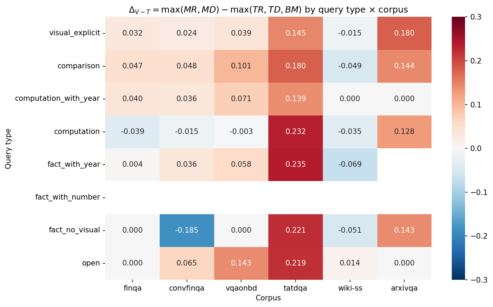
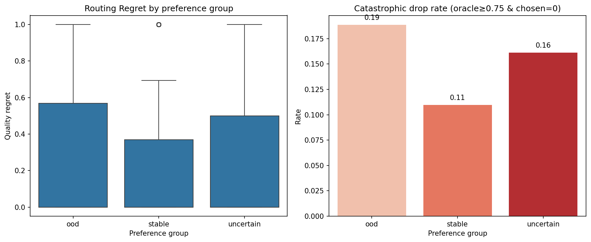

# 跨语料 Retriever 偏好冲突验证报告

## 1. Query 类型分布

| 类型 | finqa | convfinqa | vqaonbd | tatdqa | wiki-ss | arxivqa |
|---|---|---|---|---|---|---|
| visual_explicit | 461 | 152 | 82 | 114 | 9 | 591 |
| comparison | 633 | 273 | 1251 | 504 | 64 | 112 |
| computation_with_year | 3730 | 1977 | 5938 | 1347 | 6 | 1 |
| computation | 59 | 32 | 54 | 286 | 178 | 84 |
| fact_with_year | 96 | 307 | 485 | 202 | 48 | 0 |
| fact_with_number | 0 | 0 | 0 | 0 | 0 | 0 |
| fact_no_visual | 2 | 2 | 1 | 169 | 1174 | 113 |
| open | 5 | 2 | 7 | 90 | 17 | 2 |

源域（finqa/convfinqa/vqaonbd）用于定义偏好方向；目标域（tatdqa/wiki-ss/arxivqa）用于评估路由损失。

## 2. 偏好差值热力图（Δ_V-T = 多模态族最优 − 文本族最优）

红色表示多模态族更优，蓝色表示文本族更优。跨列符号变化即为潜在偏好翻转。

## 3. 冲突检测（阈值 |Δ|≥0.05，n≥50，逐目标语料库）

| 类型 | 指标 | 目标库 | 源域n | 目标n | 源域均值 | 目标均值 | 状态 |
|---|---|---|---|---|---|---|---|
| visual_explicit | delta_MR_MD | tatdqa | 695 | 114 | +0.0147 | +0.1093 | uncertain |
| visual_explicit | delta_MR_MD | wiki-ss | 695 | 9 | +0.0147 | +0.1667 | uncertain |
| visual_explicit | delta_MR_MD | arxivqa | 695 | 591 | +0.0147 | +0.2279 | uncertain |
| visual_explicit | delta_TR_TD | tatdqa | 695 | 114 | +0.0889 | +0.0400 | uncertain |
| visual_explicit | delta_TR_TD | wiki-ss | 695 | 9 | +0.0889 | +0.3049 | uncertain |
| visual_explicit | delta_TR_TD | arxivqa | 695 | 591 | +0.0889 | +0.1531 | stable |
| visual_explicit | delta_V_T | tatdqa | 695 | 114 | +0.0309 | +0.1454 | uncertain |
| visual_explicit | delta_V_T | wiki-ss | 695 | 9 | +0.0309 | -0.0145 | uncertain |
| visual_explicit | delta_V_T | arxivqa | 695 | 591 | +0.0309 | +0.1800 | uncertain |
| comparison | delta_MR_MD | tatdqa | 2157 | 504 | +0.0494 | +0.0156 | uncertain |
| comparison | delta_MR_MD | wiki-ss | 2157 | 64 | +0.0494 | +0.1541 | uncertain |
| comparison | delta_MR_MD | arxivqa | 2157 | 112 | +0.0494 | +0.1449 | uncertain |
| comparison | delta_TR_TD | tatdqa | 2157 | 504 | +0.1330 | +0.1445 | stable |
| comparison | delta_TR_TD | wiki-ss | 2157 | 64 | +0.1330 | +0.1565 | stable |
| comparison | delta_TR_TD | arxivqa | 2157 | 112 | +0.1330 | +0.0641 | stable |
| comparison | delta_V_T | tatdqa | 2157 | 504 | +0.0782 | +0.1801 | stable |
| comparison | delta_V_T | wiki-ss | 2157 | 64 | +0.0782 | -0.0494 | uncertain |
| comparison | delta_V_T | arxivqa | 2157 | 112 | +0.0782 | +0.1435 | stable |
| computation_with_year | delta_MR_MD | tatdqa | 11645 | 1347 | +0.0253 | +0.0390 | uncertain |
| computation_with_year | delta_MR_MD | wiki-ss | 11645 | 6 | +0.0253 | -0.5833 | uncertain |
| computation_with_year | delta_MR_MD | arxivqa | 11645 | 1 | +0.0253 | -1.0000 | uncertain |
| computation_with_year | delta_TR_TD | tatdqa | 11645 | 1347 | +0.1249 | +0.0992 | stable |
| computation_with_year | delta_TR_TD | wiki-ss | 11645 | 6 | +0.1249 | -0.5000 | uncertain |
| computation_with_year | delta_TR_TD | arxivqa | 11645 | 1 | +0.1249 | -1.0000 | uncertain |
| computation_with_year | delta_V_T | tatdqa | 11645 | 1347 | +0.0553 | +0.1392 | stable |
| computation_with_year | delta_V_T | wiki-ss | 11645 | 6 | +0.0553 | +0.0000 | uncertain |
| computation_with_year | delta_V_T | arxivqa | 11645 | 1 | +0.0553 | +0.0000 | uncertain |
| computation | delta_MR_MD | tatdqa | 145 | 286 | +0.0837 | +0.1055 | stable |
| computation | delta_MR_MD | wiki-ss | 145 | 178 | +0.0837 | +0.1655 | stable |
| computation | delta_MR_MD | arxivqa | 145 | 84 | +0.0837 | +0.0856 | stable |
| computation | delta_TR_TD | tatdqa | 145 | 286 | +0.1406 | +0.1292 | stable |
| computation | delta_TR_TD | wiki-ss | 145 | 178 | +0.1406 | +0.1832 | stable |
| computation | delta_TR_TD | arxivqa | 145 | 84 | +0.1406 | +0.0371 | uncertain |
| computation | delta_V_T | tatdqa | 145 | 286 | -0.0204 | +0.2321 | uncertain |
| computation | delta_V_T | wiki-ss | 145 | 178 | -0.0204 | -0.0346 | uncertain |
| computation | delta_V_T | arxivqa | 145 | 84 | -0.0204 | +0.1283 | uncertain |
| fact_with_year | delta_MR_MD | tatdqa | 888 | 202 | +0.0203 | +0.0791 | uncertain |
| fact_with_year | delta_MR_MD | wiki-ss | 888 | 48 | +0.0203 | +0.1825 | uncertain |
| fact_with_year | delta_TR_TD | tatdqa | 888 | 202 | +0.1133 | +0.0680 | stable |
| fact_with_year | delta_TR_TD | wiki-ss | 888 | 48 | +0.1133 | +0.1840 | uncertain |
| fact_with_year | delta_V_T | tatdqa | 888 | 202 | +0.0448 | +0.2345 | uncertain |
| fact_with_year | delta_V_T | wiki-ss | 888 | 48 | +0.0448 | -0.0689 | uncertain |
| fact_no_visual | delta_MR_MD | tatdqa | 5 | 169 | +0.1262 | +0.0035 | uncertain |
| fact_no_visual | delta_MR_MD | wiki-ss | 5 | 1174 | +0.1262 | +0.0679 | uncertain |
| fact_no_visual | delta_MR_MD | arxivqa | 5 | 113 | +0.1262 | +0.2539 | uncertain |
| fact_no_visual | delta_TR_TD | tatdqa | 5 | 169 | +0.2000 | -0.0305 | uncertain |
| fact_no_visual | delta_TR_TD | wiki-ss | 5 | 1174 | +0.2000 | +0.0475 | uncertain |
| fact_no_visual | delta_TR_TD | arxivqa | 5 | 113 | +0.2000 | +0.2541 | uncertain |
| fact_no_visual | delta_V_T | tatdqa | 5 | 169 | -0.0738 | +0.2210 | uncertain |
| fact_no_visual | delta_V_T | wiki-ss | 5 | 1174 | -0.0738 | -0.0515 | uncertain |
| fact_no_visual | delta_V_T | arxivqa | 5 | 113 | -0.0738 | +0.1427 | uncertain |
| open | delta_MR_MD | tatdqa | 14 | 90 | -0.0251 | +0.0420 | uncertain |
| open | delta_MR_MD | wiki-ss | 14 | 17 | -0.0251 | -0.0701 | uncertain |
| open | delta_MR_MD | arxivqa | 14 | 2 | -0.0251 | +0.0000 | uncertain |
| open | delta_TR_TD | tatdqa | 14 | 90 | +0.1441 | +0.0698 | uncertain |
| open | delta_TR_TD | wiki-ss | 14 | 17 | +0.1441 | +0.0144 | uncertain |
| open | delta_TR_TD | arxivqa | 14 | 2 | +0.1441 | -0.3155 | uncertain |
| open | delta_V_T | tatdqa | 14 | 90 | +0.0808 | +0.2188 | uncertain |
| open | delta_V_T | wiki-ss | 14 | 17 | +0.0808 | +0.0140 | uncertain |
| open | delta_V_T | arxivqa | 14 | 2 | +0.0808 | +0.0000 | uncertain |

汇总：冲突 0 组，稳定 14 组，不确定 46 组。

## 4. 目标域 Regret 按偏好组对比

| 组 | n | 平均Regret | 中位Regret | 严重掉零率 |
|---|---|---|---|---|
| ood | 1565 | 0.2889 | 0.0000 | 18.8% |
| stable | 1963 | 0.2095 | 0.0000 | 11.0% |
| conflict | 0 | - | - | - |
| uncertain | 1583 | 0.2567 | 0.0000 | 16.1% |

## 5. 按数据集分层的 Regret（控制 dataset 混淆）

| 数据集 | 组 | n | 平均Regret | 严重掉零率 |
|---|---|---|---|---|
| arxivqa | ood | 115 | 0.2534 | 17.4% |
| arxivqa | stable | 112 | 0.2249 | 13.4% |
| arxivqa | uncertain | 676 | 0.2430 | 16.7% |
| tatdqa | ood | 259 | 0.2738 | 13.5% |
| tatdqa | stable | 1851 | 0.2085 | 10.8% |
| tatdqa | uncertain | 602 | 0.2368 | 12.1% |
| wiki-ss | ood | 1191 | 0.2956 | 20.2% |
| wiki-ss | uncertain | 305 | 0.3266 | 22.6% |

## 6. 真实 Query 示例（每组3条）

### stable

- **[tatdqa]** What is the difference between the largest and smallest Value Realized on Vesting of RSUs and RSAs?
  - 类型=`comparison`，预测=`TR`，Regret=0.000，Oracle=1.000
  - 五臂nDCG: {'MR': 1.0, 'MD': 0.5, 'TR': 1.0, 'TD': 0.0, 'BM': 1.0}
- **[tatdqa]** What was the amount of accrued interest and penalties as of December 31, 2017, for the unrecognized tax benefits of on-s
  - 类型=`computation_with_year`，预测=`MR`，Regret=0.000，Oracle=1.000
  - 五臂nDCG: {'MR': 1.0, 'MD': 0.0, 'TR': 1.0, 'TD': 1.0, 'BM': 0.0}
- **[tatdqa]** What is the percentage change in research and development credits, net of uncertain tax positions, for a10-networks-inc 
  - 类型=`comparison`，预测=`MR`，Regret=0.000，Oracle=1.000
  - 五臂nDCG: {'MR': 1.0, 'MD': 0.5, 'TR': 1.0, 'TD': 0.0, 'BM': 0.6309297535714575}

### ood

- **[tatdqa]** What are insurance recoveries related to business interruption classified as?
  - 类型=`fact_no_visual`，预测=`MD`，Regret=0.000，Oracle=1.000
  - 五臂nDCG: {'MR': 0.6309297535714575, 'MD': 1.0, 'TR': 1.0, 'TD': 0.6309297535714575, 'BM': 1.0}
- **[tatdqa]** What was days inventory outstanding based on?
  - 类型=`fact_no_visual`，预测=`MR`，Regret=0.000，Oracle=1.000
  - 五臂nDCG: {'MR': 1.0, 'MD': 0.6309297535714575, 'TR': 1.0, 'TD': 0.5, 'BM': 1.0}
- **[tatdqa]** What are Restructuring Charges?
  - 类型=`fact_no_visual`，预测=`MD`，Regret=0.000，Oracle=0.387
  - 五臂nDCG: {'MR': 0.0, 'MD': 0.3868528072345416, 'TR': 0.0, 'TD': 0.0, 'BM': 0.0}

### uncertain

- **[tatdqa]** What was the cash provided by financing activities for hc2-holdings-inc in 2019?
  - 类型=`fact_with_year`，预测=`MD`，Regret=0.369，Oracle=1.000
  - 五臂nDCG: {'MR': 1.0, 'MD': 0.6309297535714575, 'TR': 0.0, 'TD': 0.0, 'BM': 0.0}
- **[tatdqa]** In which year was the amount of Losses from the disposal of fixed assets larger?
  - 类型=`computation`，预测=`TR`，Regret=1.000，Oracle=1.000
  - 五臂nDCG: {'MR': 1.0, 'MD': 1.0, 'TR': 0.0, 'TD': 0.0, 'BM': 0.0}
- **[tatdqa]** What is the respective revenue from Europe in 2018 and 2019?
  - 类型=`fact_with_year`，预测=`MD`，Regret=1.000，Oracle=1.000
  - 五臂nDCG: {'MR': 1.0, 'MD': 0.0, 'TR': 0.0, 'TD': 0.0, 'BM': 0.0}

## 7. 结论

- 稳定组平均 Regret = 0.2095（n=1963）。
- 冲突组 n=0：0.05 阈值下无明确 Query 类型级偏好反转。
- OOD 组 Regret = 0.2889（n=1565），反映 Query 覆盖不足的影响。

### 分类器修正的影响

初版分类器将含年份的事实查询（如"who won the world cup in 2011"）误归入 `computation_with_year`，制造了一个虚假冲突。修正后（年份不单独触发 computation），该冲突消失。这说明表面特征（含年份）不足以定义可比的检索需求类型。

### 语料库级偏好偏移（wiki-ss）

虽然类型级冲突不显著，但 **wiki-ss 在几乎所有 Query 类型上 Δ_V-T 均为负**（文本族更优），而源域和 tatdqa 为正（多模态更优）。具体：
- `fact_with_year`: 源域 +0.045 → wiki-ss -0.069（方向翻转，源域略低于 0.05 阈值）
- `comparison`: 源域 +0.078 → wiki-ss -0.049（方向翻转，wiki-ss 略低于阈值）
- `fact_no_visual`: wiki-ss -0.052（但源域仅 5 条，属 OOD）
这是**语料库级偏好偏移**：wiki-ss 整体偏向文本检索，而非特定 Query 类型的条件偏好反转。

### 两类问题的区分

1. **覆盖不足（Coverage Shift，主因）**：OOD 组占目标域 30.6%（1565/5111），主要是 wiki-ss 的 `fact_no_visual`（源域仅 5 条）。Regret 0.289，严重掉零率 18.8%。
2. **语料库级偏好偏移（次因）**：wiki-ss 整体偏好文本族，与源域多模态偏好相反。但在 Query 类型层面不构成稳定冲突（多数类型 |Δ|<0.05 或样本不足）。
3. **条件偏好反转（不显著）**：修正分类器后无明确类型级冲突，说明 Query 表面特征对最优臂的预测力有限。

### 决策门槛判定

本轮结果偏向 **结果B + 弱语料库偏移**：
- 主要瓶颈是训练分布覆盖不足（wiki-ss 事实查询在源域缺席）。
- wiki-ss 存在语料库级文本偏好，但未达到类型级条件冲突的统计强度。
- **不建议**投入 Preference Stability-Aware Training（缺乏显著条件冲突证据）。
- **建议**：(1) 增加源域 Query 类型多样性，覆盖事实型/百科型查询；(2) 用语料库级臂先验（Global Probe 已验证有效）处理 wiki-ss 这类整体偏移；(3) 逐 Query 路由仍应转向候选集感知特征。